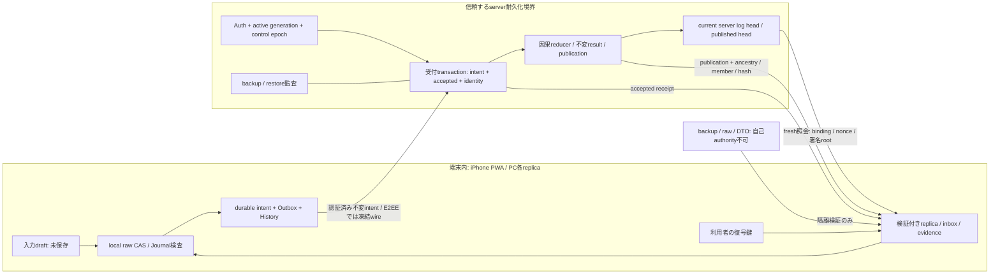

# #107 Phase 2B 実環境成立性・契約変更提案

調査日: 2026-11-10 JST。**設計レビュー待ち。実装許可ではない。**

基点: PR #126 `9a7150e9339fa1353f77e4f9853d5b7ce797c859`（模擬基盤限定APPROVE）。設計正本: PR #123 `212461c99d3556e055fb5265cbc6e4c80116f8ac`。Phase 1: `676b4da`、Phase 2A: `b3a8d47`。承認済み文書・コードは変更せず、本書の差分を独立レビューへ提出する。本提案が承認されるまで従来契約を置換しない。

## 1. 結論と保証の限界

**Firebase同期についてB（サーバー正本、ローカル検証付きreplica）を推奨する。** PR #123のimmutable intent/accepted log中心の契約を保ち、Phase 2A/2B-1で追加された「外部が端末rawの現在headを独立確認する」要件を、server logの現在head確認とローカル保存検証へ分離する設計変更である。サーバーへローカルcommitを証明する必要をなくし、ローカルCAS自体は維持する。

Aは必要な独立witnessをiPhone PWAに供給できる根拠を確認できなかった。調べた標準Web APIにその証明機構はなく、通常のPWA構成で採用可能とは判断しない。これは全ての将来の独自ハードウェア/ブラウザ拡張の不可能性証明ではない。Cは実装可能だが、端末の正しい実装・申告を信頼する保証変更であり、独立証明とは呼べない。

**Bでも、server accepted前の操作が唯一のローカル保存と共に失われた場合、別の検証済みコピー/バックアップなしには復旧できない。** 未確定入力もサーバーから復元できない。server accepted後の復旧もserver log/鍵/検証基点が残ることが前提。全保存先同時喪失、悪意ある配信JS、侵害された信頼root、無制限の障害に対する無損失は保証しない。

## 2. 調査根拠とAの成立性

### 2.1 確認した一次資料

|資料（2026-11-10参照）|確認できる事実|導けない保証|
|---|---|---|
|[IndexedDB 3.0 §transaction durability](https://www.w3.org/TR/IndexedDB-3/#transaction-durability-hint)|strict/relaxed/defaultはUAへの耐久性hint。strictは永続媒体への書込を重視する|remote verifier向けのCAS結果attestation、将来の消失防止。draftの定義を全iOSで実装済みとはしない|
|[WebAuthn Level 3](https://www.w3.org/TR/webauthn-3/#sctn-authenticator-assertion)|認証器がauthenticatorDataとclientDataHashに対する署名を返す|任意のIndexedDB transactionと同じfenceで永続化を観測した証明|
|[Apple App Attest](https://developer.apple.com/documentation/DeviceCheck/establishing-your-app-s-integrity)|登録App IDを使うapp integrityの仕組み|iPhone PWAのIndexedDB CAS観測API。native化だけでDB証明を得られるとは推定しない|
|[Firebase App Check Web](https://firebase.google.com/docs/app-check/web/recaptcha-enterprise-provider)|Web向けreCAPTCHA Enterprise providerによるApp Check|特定rawの永続化証明。custom providerを選ぶだけでは未供給witnessを解決しない|
|[WebKit Storage Policy](https://webkit.org/blog/14403/updates-to-storage-policy/)|quota、eviction、persistent要求、Home Screen利用を考慮する許可heuristics|persist要求の成功がサーバーへのcommit証明になること、永久保持|
|[Firestore transactions](https://firebase.google.com/docs/firestore/manage-data/transactions)|transactionの原子性、再試行、client offline時の失敗|FirestoreとIndexedDBをまたぐ単一transaction|
|[Firestore offline](https://firebase.google.com/docs/firestore/manage-data/enable-offline)|offline cacheと再接続、同一document変更はlast-write-wins|SDKキャッシュだけで属性intentの競合保全が成立すること|

仕様の調査結果からの**推論**: JSが「成功」として署名対象へ入れたraw hash/booleanは、そのJSによる主張である。WebAuthnのchallengeにhashを含めても認証器がIndexedDBを読んだことにはならない。別Worker、Service Worker、別タブによるreadbackもブラウザ内の同一障害/信頼境界であり、remote独立witnessへ昇格しない。TLS/Auth/App Checkも呼出元の認証等とstorage commit証明を混同しない。

### 2.2 Aに必要だが未供給のもの

端末storageをアプリJSから独立した権限で観測し、expected raw/Journal-null/targetのCASと同じfenceへ参加し、再起動後にもcommit identityを証明する保護サービスが必要。署名鍵だけでは不足する。iPhone PWAでこの役割を果たす利用可能な標準APIは上記資料から確認できない。native agentへ変更しても、Safariのorigin-private DBへ参加できる権限・OS耐久性・証明連携の実証が別途必要であり、本調査で成立とはしない。

PR #126の`authority/testing/mockAuthority.ts`は登録済み`AtomicStorage`を同一processから直接read/CASするoracleである。remote serverへこの権限があると仮定してSDKに置換しない。Aの実証がない状態で、client ACKをwitnessへ名前だけ変更する案はCに分類する。

## 3. A/B/Cの比較

|観点|A: 独立witness（供給できた場合の条件付き）|B: server durable log正本（推奨）|C: client ACKを信頼|
|---|---|---|---|
|正本/信頼|外部per-replica headと実storage witness。端末commit証明が要る|server baseline/immutable intent/accepted/result/publication。端末はreplica|外部headへ端末の成功申告を記録。申告の正しさを信頼|
|オフライン編集|現bridgeは停止。offline独立witnessがなければ不可|検証済みlocal baselineからローカルCAS/Outboxへ保存可。server受領とは別|ローカル保存可だがserver確認なし。ACK後も真の保存保証なし|
|複数端末/タブ|replicaごとのreservationとwitnessのfenceが必要|端末別actor/incarnation、同storeのraw CAS、server identity重複排除/属性DAG|同様の調停を実装できるが虚偽/誤ACKによるhead先行は防げない|
|CAS前後crash|witnessが旧/targetを独立照合できれば復旧。実PWAでは根拠不足|旧/新rawを再検証。server受領済み分はlogから再構成。未知Journalは保護|正しいclientの再照合で回復し得るがremoteは実commitを判別不能|
|commit応答喪失|pending+実witness再照合。模擬成功は実証でない|同opId+payloadでserver結果照会、localは自身を再読込。二領域の原子性不要|ACK前後の不明窓が残る。server headが真のlocalとずれる可能性|
|ローカル消失|証明は保存コピーではない。外部head hashだけでは復元不可|accepted logと鍵から復元可。未受領分は別コピーがなければ不可|head/ACKだけでは復元不可。full logも持たせるならB相当の復旧が別途必要|
|server障害|独立authority不能で新判断/書込停止（現契約）|offline保存継続可、同期状態unknown。復旧はdurable log/backup次第|offline継続可、head確認不能。ACK台帳喪失の復旧設計が必要|
|旧世代/Auth|witness・台帳・Authを同fenceで検査する難度大|server control epochと受付/公開を原子検査。offline旧操作は隔離/明示取込|同じfenceは必要。ACKは旧世代の認可を正当化しない|
|データ保護/復旧|独立性は強いがcopy/鍵/backupは別途必要|受領済みintentの再構成と候補保全。local未受領原本を上書きしない|申告故障/改ざんに弱い。ACKに基づく原本破棄は禁止すべき|
|#119 E2EE|mock同様full平文rawをserverへ渡せない。独立witness実現が難しい|暗号wire logを保持可。意味検証を分離する変更審査が必要|暗号文hashのACKは可能だが保存も復号可能性も証明しない|
|実装/運用コスト|特殊端末機構、分散reservation/recovery、対応範囲が最大の障壁|durable log、publisher、照会/再構築、backup/IAM/鍵運用。log増加・読書込増幅を測定|初期境界は小さいが誤申告/不明head復旧の運用負担。保証は低下|
|今回の判断|実端末供給根拠なし、採用保留|設計変更の承認を求める|独立証明要件を満たさず、Bに対する利点が小さい|

実価格/latencyは測定していない。二端末でも単一端末常時起動を前提にせず、server側の安全契約は省略しない。

## 4. Bの信頼境界と状態契約（変更提案）

server authorityは**serverに耐久化した事実**だけを証明する。端末rawの現在版を読めた、端末の媒体へflushできた、鍵を持つことまで証明しない。root/鍵rotation/IAM/信頼時刻/nonceはbackupから供給せず、実供給設計と監査が必要。

### 4.1 独立した四つの状態

|状態|成立条件|成立を意味しないこと|
|---|---|---|
|local persisted|binding/state/ledger/protection/evidence/採番を含む候補のraw CASがtransaction complete。そのローカル成功事実を保持|server accepted、永久保持、serverによる独立証明|
|server accepted|認証・active realm・不変identityを検証し、intent+receipt+dedup indexを同一server transactionへ保存。応答はその後|現在projectionへの反映、local保存、競合解決|
|publication applied|真正なpublicationと来歴/manifest/全memberを検証し、対応結果をローカルatomic保存。過去の反映証跡を追記|将来も競合しないこと。現在conflictやprotectedの解除|
|conflict resolved|全ての既知候補を参照する明示resolveが検証されたcurrent publicationに反映され、現在候補が解決済み|競合候補/原intentの削除、未知の並行操作が存在しないこと|

同期状態はscalar ACKへ畳まず、unreceived / awaiting / current conflict / dependency-pending / rejected / protection / inbox / serverFreshnessへ分解する。同期完了は全阻害要因0かつ現在server headの検証・local耐久化済みの時点限定。過去applied証跡とreceiptは現在conflictでも残す。R/P1/P2の全順序で最終証跡を正規化する。

fresh照会はserverの同じconsistent cutへ結び付くaccepted-log head、published head、未処理/保留集合の認証済みcommitmentを返す案とする。publication coverageにないaccepted操作が残れば、端末自身のOutboxが空でも完了にはしない。logの穴や未着memberをwatermarkだけで隠さない。SDKのcache由来snapshotやhasPendingWritesだけでfreshnessを自己生成しない。照会後に新操作が発生し得るため「全端末が今後も同期済み」というleaseにはしない。head/rootの具体形式と大規模集合の照合手順はG2/G3の実装前仕様で固定する。

### 4.2 server transactionと復旧単位

1. scopeはserverで検証したproject/UIDから決定し、mode/generation/epoch/protocolを受付時にcontrolと同じtransactionで検査。client申告UIDやbuildだけで認可しない。
2. identityはrealm+opIdに不変wire digest、actor/incarnation/seq/commandの一意性を束縛。同じidentity/同じpayloadは元receiptを返す。異payloadは双方を証跡保全して拒否/保護。timeoutで再採番しない。
3. acceptedとintent/dedupを不可分に保存。reducerはacceptedの未処理集合を処理し、result+field heads+conflicts+projection+publication headを原子更新（サイズを越える場合は不可視chunkと小さなmanifest activationを別途設計）。最大seqだけで穴を飛ばさない。
4. accepted後・reducer前crashは未処理集合から再開。publication配送はat-least-onceとして検証/重複排除。通信応答やtriggerを唯一の耐久記録にしない。
5. localはreceiptをawaitingへ移すCAS成功前にOutboxを退役しない。反映後も原操作/receipt/result/reflectionを保持し、server/端末ACKを理由にGCしない。

Firestore SDKのoffline write完了/ローカルlistenerをserver acceptedへ流用しない。通常のdocument LWWもintent reducerの代替にしない。[Firestore offline仕様](https://firebase.google.com/docs/firestore/manage-data/enable-offline)。受付transactionはserverで完了した結果を問い合わせる。transaction再試行中にメモリ採番や外部送信を副作用で行わない。[transaction仕様](https://firebase.google.com/docs/firestore/manage-data/transactions)。

### 4.3 ローカル検証・freshness・復旧の区別

local原本のchecksum/replay整合性は自己計算でも検査できるが、自己hashを真正性や「最新」の証明にしない。serverにある基点の真正性は外部rootで検証したbaseline/accepted/結果/祖先chainから得る。offline未受領suffixは**その端末で保存された未確認操作**として分離し、server由来と呼ばない。構造検査、DAG/不変payload照合、Journal/期待raw CASを通し、検査不能なら原本保護停止。

端末内だけで整合的に偽造された未受領suffixや、全ローカルpinごと古い状態へ戻されたoffline起動を独立検出する保証はBにはない。これはPhase 2Aの外部exact-current-raw floorからの保証変更である。online再接続時はfresh server headと照合し、rollback/分岐を検出する。新端末/cold restoreはbackup同梱rootを信用せず独立bootstrapが必要。offline画面は最終検証済み表示と鮮度不明/未送信を区別する。

未知raw/Journal不一致/証跡改ざん/既存protectionは自動修復しない。復旧は明示手順で原本を別保護し、server正本から**別replica候補**を再構成し、未受領操作・History・設定・未知fieldを照合してから切り替える。serverが進んでいることを理由にlocal全置換しない。server側にしかない証跡の取得と、ローカル保護解除の承認は別操作。

複数タブは同storeのraw CASとwriter/incarnation fenceで直列化し、競合した候補は再読込後に明示再評価する。通信中のAuth切替は旧handleをretireし旧scopeの応答を新scopeへinstallしない。開始済みIDB transactionの完了まで取り消せるとはしない。異世代の未送信操作は旧scopeへ保持し、明示移行mappingなしに新generationへ付け替えない。

offlineの既登録端末は最後の検証済みbindingでlocal保存できる案とする。ただしserverは失効/旧epochを受付時に拒否するため、offline保存は将来の受理保証ではない。初回enrollment/未知世代/鍵未解放は編集停止。通信不能からの通常再接続は保護解除ではなく、既存protectionを維持したfresh照会である。

## 5. crash窓と復旧可能性

ここで「復旧可」は必要原本/鍵/server記録が残る条件付き。自動保護解除やJournal clearの許可ではない。

|窓/障害|A（真のwitnessがある場合）|Bの復旧根拠・動作|Cの限界|
|---|---|---|---|
|入力中、CAS前|保存証拠なし|draft確定/別退避前の入力は保証外。serverへ未送信|ACKを先行すれば虚偽の保存記録になる|
|CAS中abort/quota/crash|witnessが旧/targetを照合|旧Committed/Journalを検査。seq/メモリ/Outbox未確定。未知なら保護|serverは旧/targetを独立判別できない|
|CAS成功、client complete応答喪失|witnessがtarget確認でfinalize|raw再読込・replay。同じopIdを保持、受領済みか照会。未知rawは保護|ACK未達ならserver head遅延、誤ACKなら先行し得る|
|local保存済み、送信前に端末消失|hashだけでは再構成不可|未受領は別copyなしに復旧不可。server acceptedと表示しない|ACKがあっても原内容のcopyなしに復旧不可|
|server受付中abort|外部台帳transactionの判定が必要|intent+receipt全件未成立か全件成立。opId照会し同payload再送|ACK方式でもserver側原子性は別途必要|
|server accepted成功、応答喪失|local証明とは別問題|fresh認証でopId+digest照会。既存receiptを耐久保存、再適用/再採番なし|local保存ACKのみからserver受領を推定できない|
|accepted後、publication前server crash|witnessだけではCloud処理復旧不可|durable未処理intentから再開。appliedと称さない|server logがなければ再処理情報不足|
|publication到着、local CAS前crash|独立witness再照合が必要|durable inboxまたはserverから同publication再取得し祖先検証。旧checkpointを戻さない|ACKが先行してもlocal反映を保証しない|
|local applied後、並行conflict到着|既存MV契約維持が必要|過去reflectionを保持しcurrent conflict別計上。後着receiptとも照合|ACKは競合解決の証明ではない|
|端末全消失、server accepted済み|外部fullコピーが別途要る|server baseline+全log+鍵で別replica再構成。device-only設定/Historyはbackup必要|ACK台帳だけでは復元不能|
|server outage/process再起動|authority停止、台帳耐久化が必要|local保存可、serverFreshness unknown。server復旧時dedup/未処理再開|可用性はあっても外部headの裏付けが弱い|
|server backup rollback/全喪失|外部headとstorageの分岐、保護|独立保持したclient pin/receiptと比較し後退検出。旧logで上書きせず停止。検証済みbackup/全端末照合で新epoch復旧を別承認|古いACK台帳を新正本にすると巻戻る|
|Auth/epoch切替中応答|witness/authority双方のfence要る|旧session応答は旧scopeへ保全、現在handleへinstall禁止。server受領事実は消さない|ACKの認証済みだった事実だけでは現在認可不可|

serverの完全喪失からclient全体を無条件に再登録して「正本復元」としない。独立の管理復旧・head/pin照合・未受領回収・世代fenceを要する。全端末が古い同じbackupでserverも後退した場合、独立に保持した新しい証跡なしに後退を検出できない。

## 6. #119の4モード・暗号方針との整合

最新要件は[Issue #119冒頭の2026-11-06方針](https://github.com/yshtysht8sh10-glitch/TaskMemoApp/issues/119)を優先する。全利用者E2EE移行の当初前提は撤回済み。

|モード|Bとの関係・禁止する混同|
|---|---|
|ローカルのみ|server acceptedなし。local durability/backup契約を別表示し、#107を理由にFirebase必須へ変更しない|
|Google Drive|開発者Firestoreへ本文/Drive tokenを中継しない。Driveの正本/変更検知/fenceは別設計。BをそのままFirestore経由で適用しない|
|Firebase E2EE|serverは凍結暗号wire intent/receipt/resultのmetadataと因果来歴を耐久保持。利用者鍵を受け取らない。現行平文MCPはこのmodeで拒否|
|Firebase標準|本文を扱う共通backend reducerが可能。認可されたMCPも同じintent受付/世代fenceを経由し、直接projectionを上書きしない|

E2EEではPhase 1の平文pure reducerをそのままserverへ載せない。公開するresource/attribute/依存metadataの範囲・漏えいを列挙し、payload（completionと日時のatomic組を含む）とreceipt内の内容を認証付き暗号で保護する。AADへmode/scope/generation/resource/group/opId/観測版/schema/keyVersionを束縛する案は暗号レビューを要する。retryは同opIdの**同一凍結ciphertext**を再送し、再暗号化した異payloadへ置換しない。公開の平文content hashをdedup値として漏らさない。

serverは公開DAG/identity/shapeまでしか検証できず、復号後のstatus/completedAt・Routine意味制約は鍵を持つclientが検証する必要がある。server acceptedは「復号・意味検証済み」を意味しない。復号失敗/未知鍵/semantic invalidはcandidateと証跡を保全して保護し、空Domainにしない。metadataと暗号payloadの不一致をどう拒否し、全端末で同一結果へ収束させるかは**実SDK前の未解決ゲート**であり、E2EE対応完了とはしない。

鍵共有/復旧は#119の利用者管理passphrase/復旧キー/端末追加の設計と別検証を要する。Authだけでは復号鍵を得られず、鍵を全て失えばserver logが残っても復元不能。backupはciphertextと全操作/競合/evidenceを保持し、復旧鍵は適切に別管理する。モード切替は別領域へ全件変換/照合後の明示世代切替とし、本提案で移行を実行しない。

E2EEの「Firebase管理権限だけでは復号不可」と、serverが常に正直であることは別。署名者/IAMを信頼するBは、悪意あるauthorityによるomission/equivocationを全面的には防がない。clientのmonotonic pin/hash chainと端末間比較で検出できる範囲はあるが、初回端末や全証跡同時後退は別trust anchorが必要。悪意あるPWA JSは鍵/平文を扱えるため絶対秘匿を広告しない。

## 7. 承認が必要な契約差分

|既存の正本/実装箇所|維持|変更提案（未承認）|
|---|---|---|
|PR #123 `02_INTENT_PROTOCOL.md` §1,4–6|immutable intent/accepted、属性DAG/MV/明示resolve、receiptとapplied分離、raw CAS/Journal/History|server正本の意味を明示。local persistedを別軸に追加。E2EEのserver意味検証境界を別規定|
|Phase 1 `publication.ts`/`acceptance.ts`|binding/checkpoint/hash/member/祖先/identity、R-F2過去reflection、現在conflict別計上|pure reducerの競合規則は変更不要。wire暗号wrapperは別審査・未実装|
|Phase 2A `local/hydration.ts` `hydrate`|原本保持、replay/manifest/payload/reflection検証、推測補完禁止|外部exact-current-local `RecoveryGuard`必須という入口を、server基点認証とlocal-only suffix検査へ分離する新入口が必要。既存APIを黙って弱めない|
|Phase 2A `local/types.ts` Envelope/RecoveryGuard|単一atomic unit、seq/ledger/inbox/evidence、guardをbackupから自己承認しない|local guardは端末内CAS/recovery検査値。server headとは別型/purposeにし、外部独立local真正性を主張しない|
|Phase 2B-1 `authority/protocol.ts` Head/Plan|Auth/session/realm/purpose/nonce/expiry/root/epoch検査|serverLogHeadとpublishedHeadを正本にする新protocol。per-replica raw guardを証明するHead/prepare→witness→finalizeを実provider契約にしない|
|Phase 2B-1 `authority/client.ts`/mock|模擬試験の成果/履歴、不正通知/旧head拒否、保護維持|実bridgeは別実装/隔離試験。offline新規書込停止を、検証済みlocal操作保存可/受領未確認へ変更する承認が必要|
|Phase 2A status / ServerObservation|未受領/awaiting/競合/保護を別判定|ServerObservationはfresh server log/published headsのみ。local persistedを証明しない。同期完了にlocal未反映/inboxを加味|
|PR #123移行runbook/backup契約|明示一度限り方式B、両端末draft回収/freeze/drain/全件照合/失敗保全|authority供給形態の差分のみ。既存データ自動変換/移行範囲縮小/rollbackの緩和なし|

ここでの「方式B」はauthority比較のB（server正本）であり、PR #123の移行方式B（明示一度限り移行）とは別の軸。両方維持する提案。承認後の仕様更新で両者を混同しない。

## 8. 実SDK接続前の必須検証条件

以下は**未実施の受入計画**。今回の文書調査やPR #126の模擬PASSを実環境PASSへ転用しない。

|ゲート|合成データ/隔離環境で必要な検証・成功条件|
|---|---|
|G1 契約差分の独立承認|§7、offline保証低下、server信頼/喪失限界、四状態の意味をレビュー承認。未承認ならSDK実装へ進まない|
|G2 耐久server受付|受付前/中/後process kill、同op同payload/異payload、二重tab/device、control切替競合。intent+receipt+dedupが全件成立/不成立で、応答喪失後も同結果を回収|
|G3 publisher再開|accepted後crash、dependency穴、順逆配送/重複、result/manifest activation途中停止。未受領をappliedとせず同集合で全証跡一致|
|G4 local障害|CAS前/中/後kill、complete応答喪失、quota、abort、Journalあり/不一致、偽raw/古backup。原本不変・採番先行なし・未知なら停止|
|G5 replica再構築|端末保存消失を合成再現しserverだけから受領済み分を復元。未受領suffix/History/設定がある復旧では別原本を保護し、全置換しない。未受領の唯一copy消失は復旧不可と正しく表示|
|G6 Auth/世代/署名|異UID/同UID新session、失効、旧epoch、期限切れ、root rotation/旧鍵、nonce replay/cold start/clock rollback。旧応答install禁止、未知rootは停止|
|G7 offline/tab/device|iPhone PWA/PCの想定で複数actor/同store CAS、長期offline、offline中失効/世代更新、再接続。拒否された旧操作は隔離保全、黙って再bindingしない|
|G8 回帰|Phase 1 58＋2A 35＋2B-1 41と独立不変条件を維持。既存12反例の証拠を削除せず、新契約へ期待値対応付け。R/P1/P2全順序・重複・JSON各段階、OFF/取消、別未送信操作保全、current conflictを比較|
|G9 server障害復旧|durable台帳再起動、backup復元/後退/分岐、二重publisherとleader epoch fence。client pinより古いserverを採用せず、明示管理復旧以外で保護解除しない|
|G10 #119 boundary|4modeの経路分離、E2EEの暗号wire不変/誤鍵/AAD/tag/metadata不一致/意味不正、鍵喪失・鍵共有・backup復元。serverに平文/key/MCP漏えいなし。server暗号意味検証の未解決事項を確定|
|G11 負荷/運用|100/500/1,000/5,000件、log増加、バッチ上限、初回一覧と同期完了を別計測。IAM/監査/backup復元/鍵rotation/runbookの費用と責任者を明確化|

G1後に初めてSDK境界の実装計画を別承認する。実SDK/DEVテストへ進む前に接続先・使い捨てアカウント・対象scope・読書込範囲・原本保護・停止手順を固定し、実機ではtransaction耐久hintの対応、強制終了・quota・offline・複数tabを別途検証する。本番データ/実ユーザー領域は使わない。製品有効化・Rules・移行・配信はさらに別承認。

## 9. レビュー担当への引き継ぎ

- 判断依頼: Bの採用と§7の変更（特にoffline local-only suffixの独立真正性を保証しない点）、A/Cを採用しない根拠、#119の未決ゲート。
- 読む順: §1–3比較 → §4状態と信頼境界 → §5 crash窓 → §6暗号 → §7契約差分 → §8受入条件。
- 既存模擬承認は維持し、実環境authenticityへ拡張解釈しない。本提案の承認も実運用真正性の実証/Phase 2B-2実装許可にはしない。
- 成果物は本書だけ。製品コード/Rules/依存/既存設計/再現証拠は非変更。文書diff・リンク・基点を検査。テスト/型/Lint/buildはコード非変更のため今回未実行。既存結果を今回のPASSとしない。
- 残リスク: 真の端末消失前未受領操作、server全喪失/悪意あるauthority、E2EE意味検証、鍵喪失、offline pin rollback、全件logの容量/起動費用。解決したとは扱わない。
- 調査方法: repository追跡済みコード/承認文書、GitHub #126独立レビューと#119最新本文、上記公式資料。Firestore/Auth SDK・本番/DEVデータ・利用者IndexedDB・配信状態にはアクセスしていない。

Issue #107へ設計PRを記録し、独立レビューを依頼して停止する。IssueはCloseしない。
