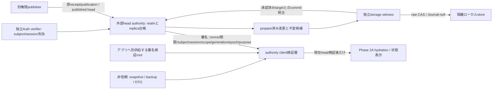

# #107 Phase 2B-1 authority境界（実装前の設計）

正本は設計212461c、Phase 1承認676b4da、Phase 2A承認b3a8d47。本書はauthorityを注入するinterface/模擬検証の設計であり、実Firestore/Auth、端末witness、実運用の真正性を実装済みとしない。承認済み文書/競合規則/Journal契約は変更しない。

## 信頼境界

1. **headの正本**: realm=(project,uid,active generation,control epoch)に属するreplica単位の外部台帳。replicaは一つの端末storage context。複数タブは同replica headをCAS競合し、別端末のlocal headを上書きしない。Cloud published headはrealm共通の別台帳で、local head/seqをCloudの勝者にしない。
2. **RecoveryGuard**: 外部台帳内の信頼済みcontext/rawとPhase 2A検証済み遷移からauthority側で生成。クライアントから任意raw/guardを承認するAPIは持たない。生成・保管は外部台帳、取得はfresh challenge付き署名応答、検証はアプリへ別供給する鍵root。snapshot/backup内の鍵・guard・署名自己申告をrootにしない。
3. **真正性**: 署名suiteとAuth verifierは注入interface。テストは別鍵のEd25519と独立したopaque session登録簿を使う。秘密鍵/issuer権限はclientへ渡さない。署名はpurpose、subject/session、replica、完全binding、nonce、発行/失効時刻、台帳version、payloadへ束縛。期限/nonce/署名だけで失効照会を省略しない。各request/commit時に外部authorityがsessionとrealmを再検査する。
4. **receipt/publication**: 別権限publisherが登録した不変通知だけを署名取得する。clientが任意通知を署名させるAPIはない。検証後にもPhase 1/2Aでpayload/hash/member/祖先を検査する。古い不変通知の再取得はあり得るが、古い署名応答を新requestへ使えず、古いpublicationでcheckpointを戻さない。
5. **ServerObservation**: realmのpublished headからのみ生成。clientがcheckpointを提出して確認済み署名を作らせない。検証済みcapabilityはメモリ内identityで管理し、同型DTO/JSONコピーで代用できない。Phase 2Aの低レベルstatus(DTO)は残すが、新bridgeはそれを未検証のまま渡すAPIを公開しない。
6. **正本への権限**: 署名検証root/clock、Auth subjectと失効、witnessと独立した台帳はsnapshotから供給しない。署名が正しくてもexpected realm/replica/session/purposeが違えば拒否。任意app-code改ざんやroot/issuer侵害をこのprototypeで防げたとは主張しない。

## commit・応答喪失

|状態|条件/処理|次状態・停止条件|
|---|---|---|
|checking|fresh signed headを取得し、期待context/realm/session/期限/nonce/rootを検査|一致するrawだけPhase 2Aでopen。不明なら原本保持で停止|
|ready|署名済みcurrent head versionを基点に構造化commandをprepare|authorityが自分の旧rawからPhase 2A遷移を計算し、不変targetを台帳へ記録|
|prepared|replicaごとに一つのpending。別tabの旧head/別commandは拒否|guardはまだcommitted headでなく書込許可。未確認targetを復元headとして使わない|
|committing|独立witnessがauthority管理のexpected/targetでraw CASしJournal-nullを検査|完了前にcounter/UI/Outboxを確定しない。realm変更は同じfence内で直列化|
|committed|witnessがtarget完全一致を確認し外部台帳をfinalize|fresh signed headを再取得してhydration。候補結果はこの後だけclientへ返す|
|commit応答不明|clientは停止。明示的recoveryが独立台帳/witnessを照会|承認済みtargetがcommit済みならheadをfinalize。旧rawのままなら同じpendingの明示retry待ち|
|unknown|rawが旧/targetのどちらでもない、Journalあり、証拠/authority不足|原本とprepare記録を残して保護停止。勝手なadopt/repair/clearなし|

prepare/commit/reconcileはrequest identityで冪等。未commitのpendingをTTLだけで消さず、再採番して失敗を隠さない。台帳/Witnessの独立性が実装できない実SDKでは本接続を有効化しない。模擬witnessはauthorityが登録した隔離AtomicStorageを自らread/CASし、clientが返したhashや「commit成功」booleanを信用しない。

## offline・切替・状態表示

- authorityに到達不能/期限切れ/失効で新規信頼判断と書込を止める。最後の検証済み値はread-only診断表示、同期完了=false。復帰しても明示retry/recoveryとfresh照会なしに自動解除しない。
- このbridgeは隔離検証用。既存のoffline保存モデルを変更しない。実運用でoffline書込を保証するには、offlineでも到達可能な独立protected authority/witness、または別途承認された可用性方針が必要。実現不能なPWAにonline必須方式を黙って本番適用しない。
- auth切替では旧clientをretireし、応答中でも旧sessionのcapabilityを新subjectへ渡さない。外部session失効を各操作で再検査。generation/epoch切替も旧handleを拒否し、旧local rawを新bindingへ書換えない。
- pending commit中のrealm activationはfenceで拒否/待機し、完了・未完了を照合してから別操作として切替。複数タブ・二重writeは同replica version/reservationで一方だけ成功。
- cold startのguard紛失は外部headの再取得で扱い、backup同梱guardで自己認証しない。既存protection/haltやJournalをauthority可用性回復の副作用で解除しない。

## 実供給で未解決の事項（次工程の前提）

実Auth session/IAM、署名鍵の保管・rotation/失効/root配布・信頼時刻・TLS、台帳の耐久性/可用性、witnessの真正なstorage commit証明、prepareとローカルcommitの分散障害回復が必要。特にiPhone PWA上のJS/IndexedDBだけでは独立protected witnessの真正性を保証できない。WebAuthn等の署名だけをstorage commit証明と同一視しない。

mockはauthority側で全synthetic rawを保持して候補を計算する。実サービスへ本文/履歴を送る可否、opaque guard/端末attestationを使う方式、#119暗号化との整合は別レビューであり、ここで実運用方式の選定済みとしない。これらを供給できない場合は設計レビューへ戻し、未確認headを採用する緩和で解決しない。

本scopeは承認設計の独立authority・停止・単調性を検証する抽象境界であり、既存動作の変更/移行/本番真正性保証ではない。実SDK/実機/P0/配信は未承認のまま残す。

## 実装したinterfaceと模擬供給

|ファイル|役割|
|---|---|
|`authority/protocol.ts`|AuthorityChannel、pinned verifier/issuer、AuthPrincipal、署名claims、head/plan/notice/observation、構造化command|
|`authority/client.ts`|fresh challenge/署名/期限/purpose/binding/session検証。独立headによるPhase 2A open、明示recover/retry、private WeakMap notice ticket、fresh server確認|
|`authority/testing/mockAuthority.ts`|clientとは別に所有する署名鍵・opaque Auth登録簿・realm/replica台帳・独立witness。authority所有rawで候補を生成し、確認したcommitのみfinalize|
|`authority/authority.test.ts`|合成値・fake IndexedDB・別Ed25519鍵を使う統合41ケース|

mockのissuer/管理publisher/provision/activateはclient channelへ公開しない。channelはguard/rawの自己承認を受け付けず、local input、登録済みnotice ID、drainだけをprepareする。全payloadをcanonicalに署名し、署名鍵は検証層へ渡さない。検証root・SHA-256・clock・nonce供給はsnapshotとは別のtrusted dependency。

requestは期待nonce/replica/purpose、replyはsessionId/完全binding/期限を束縛する。scope+generation+epochごとに不変notice IDを分離する。同じ文字列のreceipt IDが別UIDから来ても混ざらない。actor/incarnationを別replicaへ二重登録しない。authority versionはlocal revision/Cloud publicationSeqとは別で、no-opの承認でも増える場合がある。

guardはPhase 2Aの値DTOのままだが、bridgeに任意guardを受け付ける入口はない。open時に独立channelからfresh署名headを取得する。候補planのguardは署名済み書込許可に過ぎず、witness確認前のcurrent headとしては使わない。Phase 2A/Phase 1のコードと既存93件は変更していない。

## 利用者向け状態の契約（UI実装なし）

|state()/エラー|意味/次の明示操作|
|---|---|
|checking / authorityChecking=true|authority確認またはwriteの応答待ち。readOnly=true、最後の検証済みviewだけ診断用表示|
|ready|この署名応答時点のheadでhydration済み。恒久的な認証lease/同期完了ではない。各write/同期確認は再度authorityへ照会|
|blocked|offline、期限、署名、unknown authority、commit応答不明等。原本保持。自動retryせず明示recover/openで再確認|
|retry-required|witnessが旧rawのままと確認。pendingとrequest IDを残し、明示retryPreparedだけが同じpermitを消費できる|
|protected|Phase 1/2Aのprotection/haltを確認。local編集拒否、原因と既存証跡を保持。authorityの復帰でも解除しない|
|retired|Auth/scope切替で旧handleを使用不能にした状態。別subjectへ旧応答をinstallしない。新認証の新handleが必要|

status()は常にfresh署名ServerObservationを取得し、ローカルDTO引数は拒否する。未受領/awaiting/現在conflict/依存/rejected/保護/inboxの判定自体はPhase 2Aを使う。過去appliedや署名headだけで同期完了にしない。確認中/到達不能を空データや同期成功として表示してはいけない。

## commit応答喪失の具体的復旧手順

1. 失敗したhandleはblockedへ移り、原本・pending request ID・最後のviewを保持。新しいlocal操作を再採番して隠さない。
2. 利用者または上位coordinatorの明示recoverで、fresh nonceと現在Authを用いて外部authorityへ問い合わせる。同梱backup guardは送らない。
3. authorityは独立したregistered witnessからCommitted/Journalを読み、過去にprepareしたtarget/旧rawとの完全一致を検査する。clientからのhash/成功booleanだけで確定しない。
4. target一致なら、現在Auth/realmを再検査し既存requestをfinalize。新guardを署名取得してPhase 2Aで全snapshotをhydrationする。rawは書き換えない。
5. 旧raw一致なら未commitとして停止し、同requestの明示retryを要求する。元session/permitが失効していたら書き込まない。新sessionへのpermit再承認/取消は未実装で、別レビューが必要。
6. Journalあり、どちらでもないraw、未知scope/世代、証跡不足ならprotected。原本/prepare/head履歴を残し、clear/修復/自動採用しない。
7. 外部台帳自身が紛失/不明なら復旧不可として止まる。snapshotから外部台帳を再構成して信用しない。

CAS開始直前とwitnessのpost-CAS読取後にAuthを再検査する。失効前に開始したCASが後で完了した場合、ローカル原本が残ることはあるが、失効sessionに正常headを確定/返却しない。新認証による明示recoverが別途必要。既に開始したstorage transactionを失効で巻き戻せたとは主張しない。

## 必須検証と結果の対応

|要求|試験|
|---|---|
|正常head更新/独立再取得、guard紛失|別bridgeがguard引数なしで取得/hydration。bootstrap応答喪失もknown genesisへのwitness一致で明示復旧|
|旧/偽造/同梱guard|raw変更・古いbackup＋古い署名head、nonce/session/purpose/scope/generation/epoch/incarnation、偽鍵/backup rootを拒否|
|期限/失効|proof expiry、clock rollback、Auth expiry/revoke、prepare直後失効、witness読取中expiry、post-CAS失効を検証|
|応答喪失|authority finalize後のresponse lossと、local CAS後・finalize前のthrowを区別。どちらも再採番せず明示recover|
|二重write/複数tab/device|同replicaの旧versionから一方だけ成功。別deviceはheadを共有しない。clone actor登録拒否|
|auth/世代切替|old handle retire、別UID/同名receiptの分離、同UID再認証、世代/epoch fenceによる旧device遮断。pending中activation拒否|
|offline/unknown authority|新write停止、接続復帰だけでは解除しない。空になったauthority registryへローカルを自己登録しない|
|通知/ServerObservation|署名ticketのJSONコピー/期限切れ拒否。別権限publisherのR/P1/P2・重複/旧通知と現在MV候補を維持。DTOでserver確認を自作できない|
|保全|Journal/未知raw/非空bootstrapを拒否しbyte列不変。失敗時のphase/readOnly表示、受領/反映/現在conflict分離を維持|

Phase 1の58件、Phase 2Aの35件に加え、authority41件。独立レビューのF1/F2/R-F2、720ラベル通知/6操作720逐次順列等は既存テストのまま回帰ゲートとして実行する。旧12診断/PR #122証拠も変更しない。

最初の6受入はmodule未実装のimport失敗を記録後、実装して成功。開発中のpost-CAS Auth再検査は、追加反例を再検査なしの実装に適用して1 FAILを確認し、検査を追加してPASSを記録した。さらに別notice IDを使った同opId異payloadのaccepted登録を1 FAILで再現し、既存receiptを用いるPhase 1 identity検査へ接続して拒否した。模擬RPC応答のbinding参照からprivate registryを変更できる反例も1 FAILを記録後、完全copyのRPC境界を追加して遮断した。filtered実行の他37件/39件/40件は未実行であり、そのログを全41 PASSとは扱わない。

## 次の実SDK・実機検証のexit条件

1. 実providerは署名root/鍵保管/rotation/失効、Auth subject/audience/project/session/revocation、active generation/epochを独立検証できること。rootはbackup・ユーザーNode・localStorageから選択しない。
2. RPCは認証/TLS・サイズ上限・timeoutを持ち、timeoutやcancelを「未commit」と誤認しないこと。nonceはcold startをまたいで暗号学的に新規、clockは信頼できる供給と許容skewの承認が必要。今回の決定的nonce/clockはtest用。
3. 外部head台帳は耐久化し、per-replica prepare/reservation/finalize・version・過去head・command・session・witness照合を保存すること。mockはRAM内履歴のみで、authority processのcrash耐久性を証明していない。
4. 実PWA/PCでwitnessの独立性/権限とCASとのfenceを供給できること。mockの同process内登録storage readbackを、実serverがbrowser DBを直接観測できることと同一視しない。供給不能なら設計レビューへ戻る。
5. real raw/本文をauthorityへ保持/送信する可否と#119暗号化、opaque attestation方式、offline可用性を別途承認すること。今回のshadowはsynthetic rawだけを保持する試験oracleである。
6. Auth変更のclient retire通知、旧session失効、pending中のcontrol activation/fence、storage実機crash/quota/複数tabを検証すること。activation APIは旧contextのfenceモデルだけで、実世代移行/旧データ切替は実装していない。
7. P0・全旧source保全/移行/backupの別承認。既存低レベルDTO APIをUIから直接呼ばず、bridgeを迂回してguardFor/view checkpointを承認しない接続監査が必要。

これは実運用供給とauthenticityを検証するための境界モデルであり、実運用真正性/実SDK/実機/配信の承認ではない。署名/authority/registry/provisionerやapp code自体の侵害、root/信頼時刻の誤供給を防げたという保証はしない。証跡GC/compact/保護解除は実装せず、Phase 2B-2へ進まない。

## 実providerへ渡す配置要件（未実装・別レビュー）

current headの所在地は、ユーザーsnapshotとは別権限で運営するbackendのper-replica台帳を提案する。ユーザーclientが直接書けるNode/backup領域を正本にしない。台帳はactive realm/controlと同じ不可分fenceでversionを検査し、prepare/commit/過去head/失効を耐久保存する。具体的collectionやRulesをこのPRで作成/変更しない。

実Auth SDKはserver側でissuer/audience/project/subject/session失効を検証し、UIDをrequest本文から選択しない。guard issuerとpublisherは別の役割/IAMとし、署名鍵はserver/KMS等で保管、clientにはpurpose別のpinned検証鍵だけを配布する配置が必要。TLSや鍵公開を「backupに同封した鍵」と同一視しない。鍵rotation/信頼root更新の実装・審査は今回含めない。

模擬witnessはauthorityが登録したAtomicStorageへ同processでread/CASしている。実backendがiPhone PWAのDBを直接読めるわけではなく、ここが実供給の未解決箇所である。独立した端末agent/保護サービス・検証可能なcommit attestation等の方式を別途選び、実storageのtransactionと同じfenceへ結べることを立証する必要がある。署名可能な鍵があることだけでcommit済みと判定しない。これを供給できなければ実SDK接続前に設計変更レビューを要求する。

## 検証記録（2026-11-09）

|項目|今回の実行結果|
|---|---|
|focused|**134 PASS**（Phase 1 58＋Phase 2A 35＋authority 41）、6 files PASS|
|全体|**1,418 PASS / 46既存skip**、169 files PASS / 4 skip。skipは未実施|
|TypeScript/Lint|PASS、warning/error 0|
|Web export|development設定・EXPO_OFFLINE=1、4 static routes、公開設定の静的照合PASS。配信なし|
|静的scope|既存Phase 1/2A・設計・Functions/Rules/UI/依存は非変更。Production e18c4d1 ancestry、文書link/diff checkを確認|

repository外ログは`artifacts/issue107-phase2b1/`の`red.log`、`first.log`、`revocation-red.log`、`revocation-green.log`、`receipt-identity-red.log`、`transport-copy-red.log`、`authority.log`、`focused.log`、`full.log`、`types.log`、`lint.log`、`web.log`。初期Lintの重複import/未使用変数のwarningは修正後再実行し0を確認した。既知のjsdom alert未実装表示・buildのNO_COLOR通知は成功した検証と区別する。実Auth/Firestore/実witness耐久性のPASSではない。
