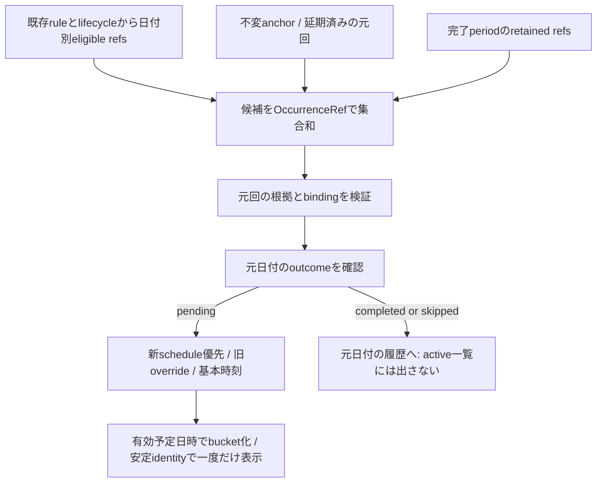

# 01 — 今回分のidentity・予定・操作・生成

本書は[レビュー入口](README.md)の設計案。以下の名前/JSONは概念であり製品schemaの割当や実装ではない。MUST/禁止はレビューを求める提案規範。

## 1. 現行コードで確認した事実

対象コードはe18c4d1。Runtime/本番実データを調べた結果ではない。

|永続/派生データ|コード|現行の意味と不足|
|---|---|---|
|Routine定義|`models/node.ts` MemoNode、`routineCategoryForMemo`|routineRoot直下のTask Memoが定義。repeatRule（frequency/interval/startsOn等）と基本dueAtを保持。独立した永続Occurrence Taskはない|
|周期による発生|`domain/routine.ts:isRepeatRuleDate`|日/週はstartsOn基準の間隔、月は開始日の日を短月でclamp、年は月日をclamp。新しいTask Nodeを作らずその日用の表示へ投影|
|当日表示|`routineOccurrenceDueAt`|当日の周期/完了/skip/lifecycleを検査し、当日keyのoverrideまたは基本時刻を返す。当日行は定義IDのままになり、元日付が省略される|
|過去未完了表示|`missedRoutineOccurrences`|startsOn/retainedから昨日まで走査。`routine-overdue:{定義ID}:{日付}`の仮ID、routineSourceId、routineOccurrenceKeyを付ける。予定日時が未来でも元日が過去ならこの経路へ入る|
|当日の期限override|`routineDueOverrides[YYYY-MM-DD]`|ISO日時またはnull。DomainのDnDは同日だけ書く。因果版/opIdのある日付移動操作ではない。nullはoverride取消として残す|
|並べ順|`routineDeadlineSortKeys[元日付]`|過去回/当日回のrank。通常TaskのdeadlineSortKeyと分離。延期先での再配置/同日複数回には再検証が必要|
|日別実績|`routineOutcomes`、`routineHistory`|outcomesのcompleted/skipped/pendingが優先、欠落日は旧Historyを参照。実績keyは発生日、changedAt/History値は実際の操作日時|
|一覧操作対象|`domain/routineListActions.ts:routineListTarget`|routineSourceIdがあれば定義へ戻し、routineOccurrenceKeyがなければ操作日のkeyを使う。この省略を日付移動後にも使うと別回を完了し得る|
|定義完了/再開|`routineLifecycle.ts`、`routineLifecycleRegister.ts`|完了時点までの発生回をperiod.retainedへ保存し、将来発生を止める。retainedと完了/skipは別。schedule変更とreadSetで連携が要る|
|履歴/Undo|`completionHistory.ts`、`nodeHistory.ts`、`taskMemoApplicationStore.ts`|元日付+完了/skip日時を表示。現行UndoはNode snapshot/旧revision前提で日別取消も特別処理。新scheduleの安全な属性Undoを既存実装が提供するとはいえない|

現在のdeadlineView.ts:594の同日制限を削るだけでは、日を跨いだ行ID/操作対象/過去投影の別bucket拒否/並べ順/同期/Undoが整合する保証はない。#130の再現は保存前のno-opであり、本設計は実行予定日を別に扱う機能拡張として審査する。

## 2. モデル比較と推奨

|案|利点|問題/判断|
|---|---|---|
|repeatRule/startsOn/定義dueAtを変更|見かけ上移動は簡単|次回生成や履歴の意味を変えるため不採用|
|Occurrenceを通常Taskへ複製|通常TaskのDnDを流用可|元Routine側との二重表示・完了帰属・削除/同期の二重正本。不要なデータモデル変更なので不採用|
|既存routineDueOverridesへ未来ISOをそのまま追加|payload差分は小さい|identity省略、取消の版/競合、元日時の固定、旧client、履歴保全を解決しない。旧overrideは互換基点として利用するが単独方式にはしない|
|**不変origin anchor＋Occurrence schedule属性**|元回と予定日を分離し、既存日別実績へ接続。明示reset/MV/Undoが定義できる|新同期への属性追加とprojection/codec/復元対応が必要。推奨。物理的な別Firestore store/History分離はここで決めない|

### 2.1 identityと不変anchor

identityは`OccurrenceRef = (definitionId, originalDateKey)`。日付は生成時の元発生日（YYYY-MM-DD）。既存日別履歴と一対一に対応させる。targetDate、現在日時、drag中の仮ID、Node updatedAtをidentityに使わない。scope/mode/generationの認証bindingは別途全操作へ束縛する。

当日/過去回を区別せず、一覧row/actionは常にOccurrenceRefを持つ。UIの安定keyはtupleを安全encodingした値（概念`occurrence/{definitionId}/{originalDateKey}`）とし、日跨ぎ/移動後も変えない。定義IDとprojection IDを混ぜず、row自体を永続Nodeとして保存しない。旧仮IDはdecode adapterで元tupleへ解決できるが、新規操作で文字列だけを推測解釈しない。

初回の明示操作で、検証済み生成根拠から次の**不変anchor**を保存候補に含める。

```text
OccurrenceAnchor {
  format: 未割当,
  definitionId, originalDateKey, baseScheduledAt,
  baseWallTime, baseOffset, calendarPolicyRef, tzRulesRef,
  calendarZone, sourceKind: verified-date | confirmed-legacy-date,
  sourceContextRef, ruleSnapshot, lifecycleSourceRef,
  legacyConfirmationRef?
}
```

baseScheduledAtは元の発生日の基本予定日時。原period/元rule/元時刻を後から変更しても書き換えない。sourceContextRefだけで内容を失わず、参照先の不変原本または完全に再検証可能なsnapshotを耐久保持する。初回作成とschedule操作は一つのatomic commandで、anchorだけ先に確定しない。

既存当日overrideがある場合、`baseScheduledAt`と移動前の有効override日時を分けて取り込む。移動前の時刻をUndoできるようpre-stateへ保存する。元の実績keyは一切変換しない。生成根拠のない旧key/矛盾するanchorは保護候補とし、日付形式だけから正当な発生回を作らない。

同じidentityへ異なるanchorが並行作成されたら、先着/時計で上書きせずsemantic conflictとして双方保持する。既存モデルでは同一定義/日付に最大一回であることを維持する。将来の#113の期間identityへ無断で読み替えない。

### 2.2 scheduleとprojection案

```text
OccurrenceSchedule =
  { kind: base } |
  { kind: at, plannedAt: canonical ISO instant,
    plannedDateKey: YYYY-MM-DD, calendarZone: IANA zone }

logical attribute = (OccurrenceRef, schedule)
Node projection候補 = routineOccurrencePlans[originalDateKey]
```

`base`はanchor.baseScheduledAtへの**明示復帰操作**。欠落やfield削除をreset/OFFに使わない。`at`は当該回の新予定日時だけで、定義のrepeatRule/startsOn/dueAtを書かない。plannedDateKeyとISO/zoneは一体の値として一致検証する。古い`at`が後着しても、観測後のbaseを巻き戻さない。

Nodeのoptional mapは表示用projectionであり、新たなwhole-map LWW正本ではない。因果head/原intent/競合候補/receipt/反映証跡は#107の正本に保持する。conflict中はcandidate refsと不確定表示を持ち、任意の日時を解決済みにしない。実フィールド名/wire version/codec形式は実装前レビューで固定する。

projection entryの概念は`{originRef, schedule: resolved(value) | conflict(candidateRefs), scheduleHeads, rankRef}`。originRefは初回commandに含めた不変anchor原本（または移行baselineの不変member）を参照し、hashだけで実体を失わない。anchor照合/暗黙取込みはschedule CASと不可分にする。未解決候補の表示は「日付を確認」一行とし、日時候補を複数Taskへ展開して重複完了できる形にしない。

この案はRoutine定義の本体にschedule projectionを関連付けられるが、単一巨大mapで全履歴を必ず読み込む物理設計を強制しない。物理分離/性能最適化は実測後の別判断。新規の実行Taskをコピー生成することとは異なる。

### 2.3 共有暦zoneの所有・version・変更境界（D1提案規範）

|管理案|利点/問題|判断|
|---|---|---|
|account一つの可変zone|操作は簡単だが変更で全Routine/過去回の意味が変わり得る|初期選択候補に限る。account default更新を既存Routineへ自動反映しない|
|**Routine単位の不変version付きCalendarPolicy**|異なる用途/国のRoutineを扱え、影響範囲を定義ごとに固定できる|推奨。generationは認証namespace/移行fenceでありzoneの所有者ではない|
|generation単位のzone一つ|全体fenceは揃うが一つのzone変更に全件再解釈/移行を要求する|不採用。generation切替で既存zone/identityを作り直さない|

`CalendarPolicy`は概念的に`{definitionId, policyId, previousPolicyRef, zone(IANA), tzRulesRef, generatorVersion, effectiveFromOriginalDate, activationCutRef}`。policyIdは不変IDで大小を勝者判定に使わず、定義のpolicy frontierと認証されたtransitionで有効版を選ぶ。scope/generation/control epochと定義config headへ束縛し、全端末が同じ版/同じzoneルールで発生日を判定する。物理schema/署名供給の実装はD3/D4で別審査。

発生日はpolicyの暦zone、表示zoneは利用端末の設定を使う。表示zone変更はinstantの表示だけで、元key/anchor/policy/発生済み集合に書き込まない。予定日のbucket判定はRoutine暦zoneを基準とし、端末表示が別日なら両日付/zoneを明示する。ドラッグ対象の「明日」も当該Routine暦zoneで具体日付に確定して確認する。異zoneのRoutineが同じ一覧にある場合、zone表示なしの共通「明日」で曖昧に保存しない。

zone変更は上書きでなく明示の新policy transitionとする。検証済みcut Tで、旧policyにより**既にrelease済みとなった元日付の上限F**（anchor済みかどうかによらない）を確定し、変更境界Bを`B > F`かつ`新zoneでのBの日の開始instant > T`となる既存暦日から本人が確認する。元日付D<Bは旧policy、D>=Bは新policyという重ならない区間を認証する。startsOn/repeatRuleを変更する操作ではない。Bが存在しない暦日/閉じた定義/比較不能policyなら通常transitionは停止し別確認。

既存anchorと旧日付区間は旧policyを永久に参照し、未anchorのrelease済み回もzone変更で再解釈しない。新policyで同じ元keyを二重生成せず、旧区間での元keyをUTCや端末の現地日へ変換しない。generation移行はpolicy原本と区間/mappingを保全し、移行先zoneへ一括置換しない。長期offline端末の旧policy操作は旧contextの原intentとして保持し、再接続時に区間・世代・cutと照合する。未確認の将来区間を旧policyで作った候補を新policyへ暗黙rebaseしない。

`tzRulesRef`は再現可能なzoneルール版/内容digestと実体参照。OSの現在Intlだけに依存して違うoffsetを同じ正解としない。版差で異なる結果になる場合は不足ルールを取得するまで検証保留、意味が一致しないなら候補保護。zone DB更新も新policyとして将来区間へ適用する案。具体ルール供給/保持・UIはD3/D4の未承認ゲートだが、D1のpure仕様では明示入力を要求する。

旧Routineのpolicy採用が未確認でFを計算できなければzone transitionも未確定とする。account defaultや端末時計を仮の証拠にしてBを決めない。

**旧Routineの最初の採用は既存policy変更と区別する。** 本人は今後の共有zoneを明示選択し、検証cut Tより後に開始する暦日Bから新policyを有効にする案。D4で照合する既存ref集合とも境界の衝突がないことを確認する。過去D<Bにzoneが不明なら未知区間のまま保全し、現在のzoneを遡及割当しない。旧回を操作する際は、対象refだけを覆う認証`legacy-adoption` contextをLegacyConfirmationから作りcalendarPolicyRefへ結ぶ。これはRoutine所属の限定的な旧回採用証拠で、通常の生成区間や別日のzoneを変更しない。全既存ref/未同期端末の照合が未完なら有効化できたとはみなさず、実行はD4未承認のまま。

### 2.4 sourceContextRef・旧回の根拠・初回anchorの許可

`SourceContext`は、認証bindingとbaseline member、そこからの定義変更/lifecycle/policy来歴、release判定のcutを結ぶ有限closure。概念形は次のとおり。

```text
SourceContextRef {
  binding, baselineManifestRef, definitionMemberRef,
  definitionChangeRefs[], lifecycleRefs[], calendarPolicyRef,
  tzRulesRef, evaluationCutRef, closureInventoryRoot,
  legacyConfirmationRef?
}
```

全参照の原payload/member/hash/祖先/結果を取得し、基点から対象回に有効だったrule・基本wall time・lifecycle・policyをreplayしてanchorを再計算する。hashだけや同梱JSONだけをauthorityにしない。新方式では#107で外部検証したbaseline/publication/controlに結ぶ。旧方式ではD4が原raw/履歴をfreeze・照合して認証baselineへ対応付けるまで、旧receiptの存在だけでその内容が反映済みだったとは推定しない。取得不能はpending、不一致/改ざんは保護停止、未知generator/schemaは推測補完禁止。

自動検証と本人の確定を分離する。

|対象|自動的に検証できる条件|本人確認が必要な不足/扱い|
|---|---|---|
|新方式の当日/過去回|認証された有効rule/policy区間でDが発生日、release時点、元wall time/offset、lifecycle適合を再計算|正常closureが完全なら過去zoneを再推定しない。UIは元日と予定を提示|
|旧当日行|原baselineの定義ID/rule/startsOn/基本dueAtと、選択されたDの整合性を旧generatorで照合できる|device-localのzone/壁時計の意図はraw ISOだけから確定できない。D・元基本wall time・IANA zone・必要offsetを明示確認|
|旧過去投影|旧仮IDを定義ID+Dへ対応し、認証原本/当時の定義変更来歴があれば当時rule/時刻を再構成|現在ruleだけでは過去の発生証明にならない。当時closure不足なら下記confirmed-legacyとして選択した回だけ確認、未確認はunresolved|
|retained[D]|認証baseline/lifecycle来歴内のmembershipと保存instantを検査し、close前発生の根拠を照合|保存instantはoverride後かもしれず元基本時刻そのものとは限らない。原rule/時刻が欠ける場合は元基本時刻を確認。retainedを黙って現ruleで上書きしない|
|旧override[D]=ISO/null|保存された値/明示取消と元keyをそのまま検証・保全。有効ISOは移動前scheduleの根拠|overrideは発生許可でも元基本時刻の証明でもない。基本anchorの根拠を別途要求。未来の予定instantでも元Dのrelease条件は緩めない|

旧zone不明時にTokyo/端末の現在zoneをdefault確定しない。本人の選択は`LegacyConfirmation`として対象raw/member digest、元ref、採用rule/基本wall time/zone/offset、確認cut/actor、表示した候補、確認範囲をimmutable記録する。これは**「その設定が歴史的に保存されていた」証明ではなく、不足情報を本人が今回明示採用した事実**。`sourceKind=confirmed-legacy-date`で区別し、自動検証済みverified-dateへ昇格させない。確認していない別日/全履歴へ適用しない。未確認原本は候補のまま保持する。

初回anchor作成は以下の全条件を満たす対象refだけ許可する。

1. 現役bindingと検証済みSourceContextを持つ。通常は有効policyによるsourceKind=verified-date。旧情報不足は認証baseline＋対象ref専用legacy-adoption context＋明示LegacyConfirmationが必要で、本人確認だけの任意Task追加へ流用しない。
2. Dは元ruleの発生日であり、その日に適用されるpolicy区間（旧回は対象限定の採用context）から得た`releaseAt(D)`（元暦日の最初の有効instant）が検証済み評価cut T以下。基本期限が夜でも当日0時以降の発生は許す。Dが未来のrule適合日というだけでは許可しない。
3. 旧回は、原本に存在する当日/過去投影の選択根拠、旧日別record/retained、または検証済み過去release履歴と対応する。旧adapterの現在ruleから全過去日を新たにmaterializeしない。不正key/生成根拠不足は保全して停止。
4. lifecycleで排除されていない（close後は認証retained/既存anchorの有効回）。pendingである因果作成contextを持ち、本人が対象回を選んだ明示moveとanchor/rankを一groupにする。completed/skippedの直接move、未確認所属変更、purge中は許可しない。
5. 発生方式は日付回（verified-date/confirmed-legacy-date）である。#113の期間型や#118の未発生回/事前表示回のanchor新設は別承認まで拒否する。通常anchorへ偽装しない。

offlineで初回anchorを確定できるのは、保存済み検証cutのrelease frontierに既に含まれ、完全closureが検証できる回だけ。端末時計を先へ進めて新しい回を許可しない。新日付がcutを越える場合は入力要求をdraftとして退避できるが、anchor/表示Taskとして確定せず接続後の再検証待ち。既存anchorの延期は旧bindingのlocal intentとして保持でき、現役世代/区間で再照合されるまでserver受領/反映済みとは呼ばない。実cut/時刻供給はD3未承認であり、pure PoCでは明示の信頼入力として注入する。

### 2.5 DST・短月・並行anchor・定義変更の規範

- 月次は対象source ruleの開始日を当月の最終日へclampし、年次は同じsource ruleの月日を当年でclampする。zone内の暦演算で、24時間加算/端末表示zoneを使わない。旧sourceのgeneratorVersionが異なればその版で再現し、#113の周期変更ルールを先行導入しない。
- 元/移動先wall timeがDST gapなら推測シフトを禁止。旧原本に元instantが保存されていればその証拠を保持し、zoneとの不一致を要確認にする。新しい予定は有効時刻を本人が選ぶまで未確定。foldなら二候補のoffset/instantを提示し一方を明示選択する。選択をanchor/scheduleと確認原本へ束縛する。丸一日欠落する暦日は通常release不能として保留し、翌日へ自動置換しない。
- 同refへ同じsemantic anchor（元rule版/policy/元wall time/offset/instant/sourceKindと確認の対応が一致）を並行作成した場合、anchorは一つへ正規化し**両操作/証拠を残す**。等価な証明closureのtransport順や取得cutの違いだけで別回を作らない。同行moveのschedule/rankは別途因果比較する。
- 同refへ異なるzone/base instant/rule由来/矛盾する確認が出た場合、anchor候補と初回move groupを共に保全し通常適用しない。保護範囲は当該Routineの新規anchor/操作で、他Routine/通常Memoは非変更。先着/updatedAtで選ばず、元refを分割して回数を増やさない。解決/保護解除手順の実装はD3/D4未承認。
- **anchor→rule変更/close**が因果順なら、既存anchorと延期先を保持。closeは当該元回をretainedへ含め、現在ruleが元日に合わなくても完了可能。
- **rule変更/close→初回anchor**が因果順なら、新しいcontextと過去closureで検証し直す。rule変更後も認証された過去release根拠があれば元回を固定できる。close後はretainedで許可された元回だけ。旧current rule/旧viewだけで許可を再利用しない。不足ならunresolvedで原本保持。
- **初回anchorと、eligibility/base/retainedを変えるrule/startsOn変更またはcloseが並行**なら、関連する初回move groupと定義変更groupの双方を意味競合として保全し、最後の検証済みRoutineをread-only表示する。到着順でanchorを消したりcloseを勝者にしない。全候補/根拠を観測した明示解決まで通常projectionを確定しない。本文だけ等、生成事実を変えない属性はこの競合へ巻き込まない。この因果oracleをD3実装済みとは主張しない。

## 3. 生成・一覧の統合アルゴリズム案



1. ruleによる通常発生日候補、過去未完了候補、lifecycle retained、移動済みanchorを集合和する。tupleごとに一つへdedupし、当日生成と過去生成を別々に表示へ足さない。anchorは既存ruleの変更後も元回の証拠になるが、未知/不正な任意keyを発生権限にはしない。
2. 元Occurrenceが有効かは**元の生成根拠**で判定。実行予定日が現在のrepeatRuleに一致する必要はない。月次13日分を14日に実施しても13日分である。既存isRoutineDueOn(実行予定日)をそのまま完了検証へ流用しない。
3. outcomeはtupleの元日付を読む。completed/skippedならactive表示から除外。pendingなら新scheduleを使い、新属性のheadがない場合だけ旧routineDueOverrides[元日付]、次に既存基本予定日時へfallbackする。明示baseは旧overrideを再適用せずanchor.baseScheduledAtを使用。
4. bucket/期限切れは有効な予定日時から決める。元日が過去でも予定が明日なら「明日」、元日が昨日でも予定が今日夜なら「今日夜」。旧`routine-overdue`という名前や元日だけを根拠に期限切れへ固定しない。
5. 11/13分を11/14へ動かした場合、11/13の今日欄から消え、11/14の予定欄に同identityで一件。日付が11/14になっても過去投影へIDを変えない。月次11/14が非発生日でも表示される。
6. 日次11/13分と通常の11/14分が同じ予定日に並ぶ場合は**二件とも残す**。「11/13分・11/14へ延期」と「11/14分」を表示し、片方の完了で他方を消さない。月次を翌月発生日まで延期した場合も同様。自動統合/置換/一括完了は禁止。
7. 遅延データ/再起動/二重受信でも同tupleを一つにする。schedule conflictは同identityの候補表示であり、別Task二件として重複生成しない。他の通常Memoの順序/完了状態を変えない。

未来の未発生回を#130単独で大量生成しない。延期済みの未来予定はanchor経由で列挙できる。#118の事前表示範囲や#113の期間内達成は別ゲート。

## 4. 操作仕様案

|操作|条件と書込|表示/保持|
|---|---|---|
|当日回→明日/別未来日|pendingかつ元回根拠検証済み。対象bucketを具体plannedAtへ変換し、変更するschedule＋rankを§4.1のgroupで更新。必要anchorも同commandで固定|元日・本体rule・次回を不変、移動先に一件|
|過去pending回→今日/未来|当日回と同じOccurrenceRef操作へ統一。旧「過去回の別bucket拒否」をこの明示操作に限り置換する提案|元回は消さず予定を更新。過去履歴の付け替えなし|
|同bucket並べ替え|既存日付別rankの考え方を維持、元refの表示rankだけ変更|通常Memo/他回の順位を勝手に初期化しない|
|別bucketへのDnD|scheduleと対象rank変更を一つのwrite-setで保存。rank計算はtarget候補/観測scheduleを再検証|半分だけの時刻/順位適用なし。相対ラベル「明日」を永続日時として保存しない|
|再移動|同refの現在schedule headを観測して新しいatを発行|新Task生成/元日変更なし。移動履歴を追記|
|「元の発生日へ戻す」|新base操作。元日が過去なら「期限切れへ戻る」確認。anchorの基本時刻へ復帰|定義編集後の新時刻へ無断追従しない|
|Undo初回/再移動|元History write-setと同じ属性集合への補償group。schedule＋rank移動は両値を戻す。両head検査/競合時の一体保留は§4.1|anchor/新fieldを削除して巻き戻さない。他回や本文/結果を戻さない|
|Redo|直前Undoの両after headを観測し、同属性集合へ元after値を再適用する新group（元操作へのredoOf）|古いopIdの再利用/Node snapshot全置換なし。片方だけRedoしない|
|完了/スキップ|元OccurrenceRefへresult操作。actual completedAt/changedAtは実操作日時|予定日/元日/実完了日時を分離、定義statusを通常Task完了へ変えない|
|完了/スキップ取消|元refのresultを明示pendingに戻す。scheduleを同時に消さない|延期済み日時のbucketへ再表示。完了日が今日だから今日の回へ変えない|
|completed/skipped回の日時変更|直接DnDは禁止、取消→pending→移動を明示|完了済み履歴の意味を黙って書換えない|

延期先は原則`plannedDateKey >= originalDateKey`。未発生の未来回を前倒し実行する機能は#118。元日への復帰は過去時刻でも許すが、過去日への誤移動は確認する。初期DnDの「期限切れ」「期限なし」は具体予定日時を確定できないため、無説明no-opにせず理由表示/日時指定へ誘導する。later/来月/来年等の範囲は#102と同様に具体日時確認後だけ保存する。

drag開始時に元refを固定し、日付が変わっても当日refへ置換しない。target「明日」はdrop時の暦日から候補を作り、確認中の深夜跨ぎでは画面の具体日時を維持して再確認。保存直前に現役scope、元回、outcome、schedule/readSet、target日時を再検証する。不一致なら再確認/競合保全で、黙って別回を移動しない。

通常の設定画面からrepeatRule/startsOnを変更する操作とは別command。定義のタイトル/本文を編集するときだけ定義IDを使い、メニュー・一括移動・完了ボタン・アクセシビリティ操作は元OccurrenceRefを渡す。一括操作は選択ref集合を固定し、同じ定義の二回を定義IDだけでdedupしない。

### 4.1 R131-1 — History write-setとatomic補償（D2提案規範）

**基本案は移動group全体をUndo/Redoする。rankをUndo対象外に残す案は採用しない。** scheduleだけをS0へ戻して別bucket用r1を残す、またはschedule headだけを見てremote rankを消す部分適用を禁止する。

History commandは概念的に次を保持する。UIの一操作一Historyは、原commandと補償来歴のまとまりを指し、Undo/Redoの原intentを消して一件に見せる意味ではない。

```text
HistoryCommand {
  historyId, groupId, occurrenceRefs[], sourceContextRefs[], originRefs[],
  writeSet: [{ ref, attribute, beforeValue, beforeHeads,
               afterValue, producedHeads, operationRefs }],
  readSet: [{ ref, attribute, observedHeads, predicate }],
  originalCommandRefs[], compensationRefs[], currentReplayStage
}
```

別bucket移動MのwriteSetはscheduleとrankの両方。必要な初回anchorと原本参照もatomic候補へ含めるが、anchorはUndoで削除しない。rank-only並べ替えQのwriteSetはrankのみ、scheduleはrankの有効bucketを検証するreadSet contextへ置く。rank値はそのschedule/絶対予定日との対応を記録し、永続値に相対「明日」だけを持たせない。

legacy rankが未設定なら`beforeValue=inherit(検証済み元bucket順のbaselineRef)`のような明示値を記録する案とし、field削除で無版のfallbackへ戻さない。初回移動前の有効scheduleが旧overrideなら、そのISO/zone/offsetと旧null/欠落の由来をbeforeに保持する。これをUndoで明示atまたはbaseへ写像し、旧mapそのものは削除しない。正確なwire表現はD3/D4で別審査。

**競合なしのM Undo手順**:

1. Mとその後の補償来歴/原証拠を再検証し、対象属性集合をHistoryから固定する（画面bucketから推測しない）。初回anchor/sourceContextが依然有効かも検査する。
2. schedule/rank各属性の因果frontierが、現在replay stageのproducedHeadsと**それぞれ完全一致**することを要求する。値がS1/r1と同じでも新headがあれば無条件Undoしない。source/bindingや必要readSetも検証する。
3. 新Undo group U（undoOf=M）は同じwriteSetにbefore値S0/r0を設定し、現在の両frontierを観測基点にする。rankのみの元操作ならrankだけを補償し、schedule contextの前提を再検証する。
4. group全属性とHistory/送信義務/証拠を同じraw CAS候補にする。成功時は両属性へ新しいU由来headを作る。S0/r0という値に戻っても過去headを再利用しない。
5. 一属性の検証/保存失敗、quota/abort、片側member欠落ではgroupを全体保留/失敗にし、両値・両head・確定History stageを進めない。応答喪失は旧/全targetの確認までunknownで、片側成功を完了として扱わない。受領receiptだけでgroup適用済みやUndo成功にしない。

**remote片属性変更時**: M後にremote rank-only Qがr2/headQへ変えた場合、schedule headがMのままでもM Undoを一体保留する。現在S1/r2を維持し、UのS0/r0は未適用の補償候補として全group/元M/Qと共に保全する。remote schedule-onlyがS2/headZへ変えた場合も同様に現在S2/r1を保ち、rankだけ先にr0へ戻さない。候補値だけの比較や「自分の属性は勝った」部分Undoは禁止。

保留理由をUIへ表示し、無条件上書きではなく全候補/両属性を観測する明示解決groupを求める。確認でremote変更を残す選択も可能だが、それはMの無競合Undoとは別の明示解決操作である。遠隔操作とUが並行なら、到着順によりUを片側だけ適用せず、関連groupの意味競合を検出し候補/来歴を正規化する。具体reducerとconflict解決実装はD3未承認。

既にremote Qを知ってhead不一致になった**Undo要求の事前保留**と、Qを知らずMのheadを観測して発行したUとQの**真の並行**は区別する。前者はQの現在S1/r2を維持して未適用要求を保存する。後者はUの組(S0,r0)と、Qの因果基点を含む組(S1,r2)をgroup候補として保全し、一行の未解決表示にする。scheduleだけS0を確定しrankだけ競合にする表現や、S0/r2を正常値とする合成を禁止。schedule-only remoteなら組(S2,r1)との競合になる。

真の並行の最終候補/History状態は同じ操作集合から同じ結果へ正規化する。先にUがappliedだった証跡は後発Qで消さず、現在group-conflictと分ける。最後の端末ローカル表示を診断として残すことはできるが、それを全端末共通の解決済みprojectionとは呼ばない。

**rank-only Q Undo/Redo**はrankのbefore/afterとheadだけを書き戻す。scheduleは書かないが、そのhead/bucket前提が変わっていればQ全体を保留し、別bucketへ古rankを持ち込まない。無競合ならrank r0→r1→Undo r0→Redo r1、各段階で新headを作る。scheduleや結果/他refは一切補償しない。

**Redo M**は最後の成功Undo Uの両producedHeadsと現在frontierを検査し、新R groupでMのafter値S1/r1を両方再適用する。U後にどちらかだけ変わってもRedoは一体保留。再試行は同じrequest/op identityで冪等、成功済み補償の重複配送でHistory件数/反映回数を増やさない。新しい通常操作でRedoを無効化する場合も原M/Uの証拠は消さない。

**完了/取消後の移動Undo**: resultはMのwriteSet外なので、遠隔完了やその取消だけでschedule/rankの無競合判定を壊さない。対象両headがM由来のままならMを両値補償でき、outcomeはcompleted/skipped/pendingの現在値を維持する。完了済み行は隠れたまま、後に取消すれば補償後のS0/r0へ表示される。完了時のactor観測予定snapshotは不変。これは新規completed回DnDを許可するのではなく、元moveを指定する補償操作である。通常のUndo stack順では、自分の完了commandが上にあれば先にそれを戻す。Redoも同じ属性境界を守る。

Historyのlocal pending stageと確定適用stageを分離する。local CASでU候補を保持してもserver acceptedだけで確定cursorを進めず、検証したgroup適用とlocal保存に対応付ける。競合/保存失敗ならMを「Undo済み」にせずpending/blocked表示を残す。実際のoffline preview/cursor/永続adapterはD3/D4側で設計・承認する必要がある。

他ref/通常Memo/本文/resultの値・head・候補を元Node snapshotから再生してはならない。同じr0へ戻しても別の人が他行を移動した後の絶対画面indexまで復元する保証はなく、その外部変更を巻き戻さず当該refのrankだけを復帰させる。

## 5. 定義の変更・完了・削除と履歴

- **次回生成**: 移動はrepeatRule/startsOnを触らず、将来の既存generatorを変えない。11/13月次を14日に移しても12/13分は通常生成し、12/14へずれない。
- **rule変更**: materialize済みanchorの元回と延期先は保持。新しいruleで元日が非発生日になっても消さない。未materializeの過去回の扱いを#130で遡及変更せず、#101/#113の別設計へ残す。新旧ruleで同じ元日が候補になっても既存最大一回identityを守る。
- **定義close**: 既に発生して延期したpending回は、実行予定日がclose後でも保持する。retainedは元発生日基準でanchorと照合し、新しい回の発生だけ停止。closeとschedule変更が並行するときはconfig/lifecycle/readSet依存を検証し、解釈が分かれる組合せを意味競合にする。閉じた定義の保持済みpending回の再延期は許す案。
- **再開**: retained/anchorと新rule候補をtupleでdedupし、旧延期回を新しい回として複製しない。
- **削除/所属変更**: soft-deleteはactive表示を隠すが原anchor/schedule/実績をtombstone側へ保持。restoreでscheduleを維持。所属がRoutineでなくなった操作と並行moveは意味競合/停止で、移動操作が定義を復活させない。purge/新GCは本scope外。
- **履歴**: 完了表示のkeyは引き続き定義ID+元日付。元発生日、当該完了時点の予定日時snapshot、実完了/skip日時を表示できる記録を追加する案。後のschedule変更で過去の「その時点の予定」を書換えない。旧履歴に予定snapshotがない場合は「未記録」で保持し、現在設定から捏造しない。Undo/Redoで作った取消/再適用の来歴も保持する。

## 6. 属性の合成・競合（#107との接続仕様案）

scheduleとresultは別の属性group。本文/別refの日付変更は独立に合成する。同じrefで二端末が異なる予定へ並行移動したら両候補をMV保持し、到着順/updatedAt/大きいNode revisionで勝者にしない。全候補を観測する明示resolveだけが解決できる。解除/元日復帰も因果後続の新操作であり、古い移動の再送は復帰を上書きできない。

移動と完了が並行する場合は、resultは元refを完了し、schedule候補/移動来歴を残す（完了状態をpendingへ戻さない）。本案の完了は元回の実施を意味し予定時刻に依存しないため、result操作自体は「表示していたschedule」へreadSet依存させない。完了時snapshotは当該actorが観測した予定とそのheadを記録し、「同時点の全端末確定予定」と偽らない。予定が競合中でもexplicit refで完了できるが、schedule競合は未解決として保全し、完全同期とは表示しない。

一方、移動先rankの計算やclose時のretained計算など値が他属性に依存する処理はreadSetを持つ。並行のresult完了後に新しい通常DnDを始めることはUIで禁止するが、発行済み並行moveを捨ててなかったことにはしない。既に結果が変わったことを観測済みの古いbeforeによるmoveは再確認待ちとして原intentを保全する。到着時のcurrent値だけで先着勝者を作らず、因果closureに基づいて同集合から同結果を計算する。

この区別のため、moveの作成contextには観測outcome head/値を記録する案とする。検証済み因果基点でpendingであったmoveと並行completeは合成可能。一方、因果基点ですでにcompleted/skippedなら通常moveを受理しない。ここでoutcomeを「受信時currentと一致すること」というreadSetへ置換すると到着順依存になるため禁止する。この因果predicateの具体schema/validatorはD3の独立承認対象で、現行#107実装に存在するとは主張しない。

Undo/Redoの対象集合・両属性headの検証・group全体保留は§4.1を正本とする。既存receipt ACKだけで意図実現とみなさず、server accepted/local persisted/publication applied/current conflict resolvedを区別する。
