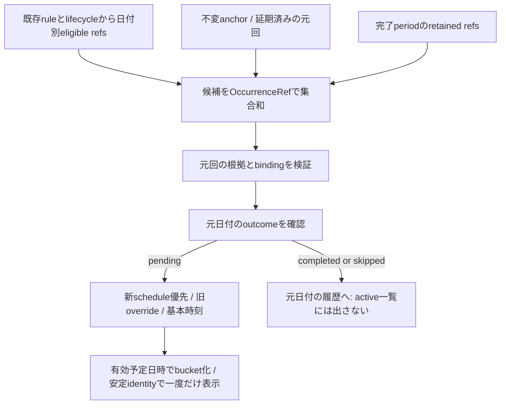

# 01 — 今回分のidentity・予定・操作・生成

本書は[レビュー入口](README.md)の設計案。以下の名前/JSONは概念であり製品schemaの割当や実装ではない。MUST/禁止はレビューを求める提案規範。

## 1. 現行コードで確認した事実

対象コードはe18c4d1。Runtime/本番実データを調べた結果ではない。

|永続/派生データ|コード|現行の意味と不足|
|---|---|---|
|Routine定義|`models/node.ts` MemoNode、`routineCategoryForMemo`|routineRoot直下のTask Memoが定義。repeatRule（frequency/interval/startsOn等）と基本dueAtを保持。独立した永続Occurrence Taskはない|
|周期による発生|`domain/routine.ts:isRepeatRuleDate`|日/週はstartsOn基準の間隔、月は開始日の日を短月でclamp、年は月日をclamp。新しいTask Nodeを作らずその日用の表示へ投影|
|当日表示|`routineOccurrenceDueAt`|当日の周期/完了/skip/lifecycleを検査し、当日keyのoverrideまたは基本時刻を返す。当日行は定義IDのままになり、元日付が省略される|
|過去未完了表示|`missedRoutineOccurrences`|startsOn/retainedから昨日まで走査。`routine-overdue:{定義ID}:{日付}`の仮ID、routineSourceId、routineOccurrenceKeyを付ける。予定日時が未来でも元日が過去ならこの経路へ入る|
|当日の期限override|`routineDueOverrides[YYYY-MM-DD]`|ISO日時またはnull。DomainのDnDは同日だけ書く。因果版/opIdのある日付移動操作ではない。nullはoverride取消として残す|
|並べ順|`routineDeadlineSortKeys[元日付]`|過去回/当日回のrank。通常TaskのdeadlineSortKeyと分離。延期先での再配置/同日複数回には再検証が必要|
|日別実績|`routineOutcomes`、`routineHistory`|outcomesのcompleted/skipped/pendingが優先、欠落日は旧Historyを参照。実績keyは発生日、changedAt/History値は実際の操作日時|
|一覧操作対象|`domain/routineListActions.ts:routineListTarget`|routineSourceIdがあれば定義へ戻し、routineOccurrenceKeyがなければ操作日のkeyを使う。この省略を日付移動後にも使うと別回を完了し得る|
|定義完了/再開|`routineLifecycle.ts`、`routineLifecycleRegister.ts`|完了時点までの発生回をperiod.retainedへ保存し、将来発生を止める。retainedと完了/skipは別。schedule変更とreadSetで連携が要る|
|履歴/Undo|`completionHistory.ts`、`nodeHistory.ts`、`taskMemoApplicationStore.ts`|元日付+完了/skip日時を表示。現行UndoはNode snapshot/旧revision前提で日別取消も特別処理。新scheduleの安全な属性Undoを既存実装が提供するとはいえない|

現在のdeadlineView.ts:594の同日制限を削るだけでは、日を跨いだ行ID/操作対象/過去投影の別bucket拒否/並べ順/同期/Undoが整合する保証はない。#130の再現は保存前のno-opであり、本設計は実行予定日を別に扱う機能拡張として審査する。

## 2. モデル比較と推奨

|案|利点|問題/判断|
|---|---|---|
|repeatRule/startsOn/定義dueAtを変更|見かけ上移動は簡単|次回生成や履歴の意味を変えるため不採用|
|Occurrenceを通常Taskへ複製|通常TaskのDnDを流用可|元Routine側との二重表示・完了帰属・削除/同期の二重正本。不要なデータモデル変更なので不採用|
|既存routineDueOverridesへ未来ISOをそのまま追加|payload差分は小さい|identity省略、取消の版/競合、元日時の固定、旧client、履歴保全を解決しない。旧overrideは互換基点として利用するが単独方式にはしない|
|**不変origin anchor＋Occurrence schedule属性**|元回と予定日を分離し、既存日別実績へ接続。明示reset/MV/Undoが定義できる|新同期への属性追加とprojection/codec/復元対応が必要。推奨。物理的な別Firestore store/History分離はここで決めない|

### 2.1 identityと不変anchor

identityは`OccurrenceRef = (definitionId, originalDateKey)`。日付は生成時の元発生日（YYYY-MM-DD）。既存日別履歴と一対一に対応させる。targetDate、現在日時、drag中の仮ID、Node updatedAtをidentityに使わない。scope/mode/generationの認証bindingは別途全操作へ束縛する。

当日/過去回を区別せず、一覧row/actionは常にOccurrenceRefを持つ。UIの安定keyはtupleを安全encodingした値（概念`occurrence/{definitionId}/{originalDateKey}`）とし、日跨ぎ/移動後も変えない。定義IDとprojection IDを混ぜず、row自体を永続Nodeとして保存しない。旧仮IDはdecode adapterで元tupleへ解決できるが、新規操作で文字列だけを推測解釈しない。

初回の明示操作で、検証済み生成根拠から次の**不変anchor**を保存候補に含める。

```text
OccurrenceAnchor {
  format: 未割当,
  definitionId, originalDateKey, baseScheduledAt,
  calendarZone, sourceKind: legacy-date,
  sourceContextRef, ruleSnapshot, lifecycleSourceRef
}
```

baseScheduledAtは元の発生日の基本予定日時。原period/元rule/元時刻を後から変更しても書き換えない。sourceContextRefだけで内容を失わず、参照先の不変原本または完全に再検証可能なsnapshotを耐久保持する。初回作成とschedule操作は一つのatomic commandで、anchorだけ先に確定しない。

既存当日overrideがある場合、`baseScheduledAt`と移動前の有効override日時を分けて取り込む。移動前の時刻をUndoできるようpre-stateへ保存する。元の実績keyは一切変換しない。生成根拠のない旧key/矛盾するanchorは保護候補とし、日付形式だけから正当な発生回を作らない。

同じidentityへ異なるanchorが並行作成されたら、先着/時計で上書きせずsemantic conflictとして双方保持する。既存モデルでは同一定義/日付に最大一回であることを維持する。将来の#113の期間identityへ無断で読み替えない。

### 2.2 scheduleとprojection案

```text
OccurrenceSchedule =
  { kind: base } |
  { kind: at, plannedAt: canonical ISO instant,
    plannedDateKey: YYYY-MM-DD, calendarZone: IANA zone }

logical attribute = (OccurrenceRef, schedule)
Node projection候補 = routineOccurrencePlans[originalDateKey]
```

`base`はanchor.baseScheduledAtへの**明示復帰操作**。欠落やfield削除をreset/OFFに使わない。`at`は当該回の新予定日時だけで、定義のrepeatRule/startsOn/dueAtを書かない。plannedDateKeyとISO/zoneは一体の値として一致検証する。古い`at`が後着しても、観測後のbaseを巻き戻さない。

Nodeのoptional mapは表示用projectionであり、新たなwhole-map LWW正本ではない。因果head/原intent/競合候補/receipt/反映証跡は#107の正本に保持する。conflict中はcandidate refsと不確定表示を持ち、任意の日時を解決済みにしない。実フィールド名/wire version/codec形式は実装前レビューで固定する。

projection entryの概念は`{originRef, schedule: resolved(value) | conflict(candidateRefs), scheduleHeads, rankRef}`。originRefは初回commandに含めた不変anchor原本（または移行baselineの不変member）を参照し、hashだけで実体を失わない。anchor照合/暗黙取込みはschedule CASと不可分にする。未解決候補の表示は「日付を確認」一行とし、日時候補を複数Taskへ展開して重複完了できる形にしない。

この案はRoutine定義の本体にschedule projectionを関連付けられるが、単一巨大mapで全履歴を必ず読み込む物理設計を強制しない。物理分離/性能最適化は実測後の別判断。新規の実行Taskをコピー生成することとは異なる。

### 2.3 日付とzoneの前提（公開前ゲート）

元日付は既存keyを保存し、UTCへ変換してkeyを書き換えない。予定日時はinstant+明示zone+そのzoneでのdateKeyを保持する。単純な24時間加算で翌日/月末を求めず、選択された暦日で計算する。表示端末zoneと発生identityを分け、timezone変更で別Occurrenceを作らない。

現行はdevice-local生成であり、既存データだけから全回のIANA zoneは確定できない。**機能有効化時に参加端末が共有するRoutine暦zoneの明示確認を要する案**とし、既存dateKeyをそのzoneでreinterpretしない。新しくanchorを固定する対象回は本人が見ている元日付/根拠を照合する。曖昧な旧回は候補保全で止める。全旧Routineのzoneを一律Tokyoと推定して移行しない。

zone選択UI/有効化範囲・DSTの存在しない/二重の時刻の選択規則は独立レビューの決定項目。提案は存在しない時刻を拒否し、二重時刻はoffsetを明示確認すること。共有zoneの選定と旧回照合が未承認なら、異zone端末への公開保証を満たしたとして有効化しない。これはrepeatRule/startsOnを変更する操作ではない。

既存未操作Routineのdevice-local表示を、このzone field追加だけで一括変更しない。共有zone導入で従来generatorの意味に差が出る端末/回は移行の照合対象とし、旧key/旧表示との対応が承認されるまで新機能の公開を閉じる。「zoneを保存したので全旧回も安全」とは判断しない。

## 3. 生成・一覧の統合アルゴリズム案



1. ruleによる通常発生日候補、過去未完了候補、lifecycle retained、移動済みanchorを集合和する。tupleごとに一つへdedupし、当日生成と過去生成を別々に表示へ足さない。anchorは既存ruleの変更後も元回の証拠になるが、未知/不正な任意keyを発生権限にはしない。
2. 元Occurrenceが有効かは**元の生成根拠**で判定。実行予定日が現在のrepeatRuleに一致する必要はない。月次13日分を14日に実施しても13日分である。既存isRoutineDueOn(実行予定日)をそのまま完了検証へ流用しない。
3. outcomeはtupleの元日付を読む。completed/skippedならactive表示から除外。pendingなら新scheduleを使い、新属性のheadがない場合だけ旧routineDueOverrides[元日付]、次に既存基本予定日時へfallbackする。明示baseは旧overrideを再適用せずanchor.baseScheduledAtを使用。
4. bucket/期限切れは有効な予定日時から決める。元日が過去でも予定が明日なら「明日」、元日が昨日でも予定が今日夜なら「今日夜」。旧`routine-overdue`という名前や元日だけを根拠に期限切れへ固定しない。
5. 11/13分を11/14へ動かした場合、11/13の今日欄から消え、11/14の予定欄に同identityで一件。日付が11/14になっても過去投影へIDを変えない。月次11/14が非発生日でも表示される。
6. 日次11/13分と通常の11/14分が同じ予定日に並ぶ場合は**二件とも残す**。「11/13分・11/14へ延期」と「11/14分」を表示し、片方の完了で他方を消さない。月次を翌月発生日まで延期した場合も同様。自動統合/置換/一括完了は禁止。
7. 遅延データ/再起動/二重受信でも同tupleを一つにする。schedule conflictは同identityの候補表示であり、別Task二件として重複生成しない。他の通常Memoの順序/完了状態を変えない。

未来の未発生回を#130単独で大量生成しない。延期済みの未来予定はanchor経由で列挙できる。#118の事前表示範囲や#113の期間内達成は別ゲート。

## 4. 操作仕様案

|操作|条件と書込|表示/保持|
|---|---|---|
|当日回→明日/別未来日|pendingかつ元回根拠検証済み。対象bucketを具体plannedAtへ変換、scheduleのみ更新。必要anchorを同commandで固定|元日・本体rule・次回を不変、移動先に一件|
|過去pending回→今日/未来|当日回と同じOccurrenceRef操作へ統一。旧「過去回の別bucket拒否」をこの明示操作に限り置換する提案|元回は消さず予定を更新。過去履歴の付け替えなし|
|同bucket並べ替え|既存日付別rankの考え方を維持、元refの表示rankだけ変更|通常Memo/他回の順位を勝手に初期化しない|
|別bucketへのDnD|scheduleと対象rank変更を一つのwrite-setで保存。rank計算はtarget候補/観測scheduleを再検証|半分だけの時刻/順位適用なし。相対ラベル「明日」を永続日時として保存しない|
|再移動|同refの現在schedule headを観測して新しいatを発行|新Task生成/元日変更なし。移動履歴を追記|
|「元の発生日へ戻す」|新base操作。元日が過去なら「期限切れへ戻る」確認。anchorの基本時刻へ復帰|定義編集後の新時刻へ無断追従しない|
|Undo初回/再移動|対象scheduleの直前値への補償intent。初回前に旧当日overrideがあればその有効時刻を明示atで復帰|anchor/新fieldを削除して巻き戻さない。他回や本文/結果を戻さない|
|Redo|新しい観測基点/identityで再適用intent（元操作へのredoOf）|古いopIdの再利用/Node snapshot全置換なし|
|完了/スキップ|元OccurrenceRefへresult操作。actual completedAt/changedAtは実操作日時|予定日/元日/実完了日時を分離、定義statusを通常Task完了へ変えない|
|完了/スキップ取消|元refのresultを明示pendingに戻す。scheduleを同時に消さない|延期済み日時のbucketへ再表示。完了日が今日だから今日の回へ変えない|
|completed/skipped回の日時変更|直接DnDは禁止、取消→pending→移動を明示|完了済み履歴の意味を黙って書換えない|

延期先は原則`plannedDateKey >= originalDateKey`。未発生の未来回を前倒し実行する機能は#118。元日への復帰は過去時刻でも許すが、過去日への誤移動は確認する。初期DnDの「期限切れ」「期限なし」は具体予定日時を確定できないため、無説明no-opにせず理由表示/日時指定へ誘導する。later/来月/来年等の範囲は#102と同様に具体日時確認後だけ保存する。

drag開始時に元refを固定し、日付が変わっても当日refへ置換しない。target「明日」はdrop時の暦日から候補を作り、確認中の深夜跨ぎでは画面の具体日時を維持して再確認。保存直前に現役scope、元回、outcome、schedule/readSet、target日時を再検証する。不一致なら再確認/競合保全で、黙って別回を移動しない。

通常の設定画面からrepeatRule/startsOnを変更する操作とは別command。定義のタイトル/本文を編集するときだけ定義IDを使い、メニュー・一括移動・完了ボタン・アクセシビリティ操作は元OccurrenceRefを渡す。一括操作は選択ref集合を固定し、同じ定義の二回を定義IDだけでdedupしない。

## 5. 定義の変更・完了・削除と履歴

- **次回生成**: 移動はrepeatRule/startsOnを触らず、将来の既存generatorを変えない。11/13月次を14日に移しても12/13分は通常生成し、12/14へずれない。
- **rule変更**: materialize済みanchorの元回と延期先は保持。新しいruleで元日が非発生日になっても消さない。未materializeの過去回の扱いを#130で遡及変更せず、#101/#113の別設計へ残す。新旧ruleで同じ元日が候補になっても既存最大一回identityを守る。
- **定義close**: 既に発生して延期したpending回は、実行予定日がclose後でも保持する。retainedは元発生日基準でanchorと照合し、新しい回の発生だけ停止。closeとschedule変更が並行するときはconfig/lifecycle/readSet依存を検証し、解釈が分かれる組合せを意味競合にする。閉じた定義の保持済みpending回の再延期は許す案。
- **再開**: retained/anchorと新rule候補をtupleでdedupし、旧延期回を新しい回として複製しない。
- **削除/所属変更**: soft-deleteはactive表示を隠すが原anchor/schedule/実績をtombstone側へ保持。restoreでscheduleを維持。所属がRoutineでなくなった操作と並行moveは意味競合/停止で、移動操作が定義を復活させない。purge/新GCは本scope外。
- **履歴**: 完了表示のkeyは引き続き定義ID+元日付。元発生日、当該完了時点の予定日時snapshot、実完了/skip日時を表示できる記録を追加する案。後のschedule変更で過去の「その時点の予定」を書換えない。旧履歴に予定snapshotがない場合は「未記録」で保持し、現在設定から捏造しない。Undo/Redoで作った取消/再適用の来歴も保持する。

## 6. 属性の合成・競合（#107との接続仕様案）

scheduleとresultは別の属性group。本文/別refの日付変更は独立に合成する。同じrefで二端末が異なる予定へ並行移動したら両候補をMV保持し、到着順/updatedAt/大きいNode revisionで勝者にしない。全候補を観測する明示resolveだけが解決できる。解除/元日復帰も因果後続の新操作であり、古い移動の再送は復帰を上書きできない。

移動と完了が並行する場合は、resultは元refを完了し、schedule候補/移動来歴を残す（完了状態をpendingへ戻さない）。本案の完了は元回の実施を意味し予定時刻に依存しないため、result操作自体は「表示していたschedule」へreadSet依存させない。完了時snapshotは当該actorが観測した予定とそのheadを記録し、「同時点の全端末確定予定」と偽らない。予定が競合中でもexplicit refで完了できるが、schedule競合は未解決として保全し、完全同期とは表示しない。

一方、移動先rankの計算やclose時のretained計算など値が他属性に依存する処理はreadSetを持つ。並行のresult完了後に新しい通常DnDを始めることはUIで禁止するが、発行済み並行moveを捨ててなかったことにはしない。既に結果が変わったことを観測済みの古いbeforeによるmoveは再確認待ちとして原intentを保全する。到着時のcurrent値だけで先着勝者を作らず、因果closureに基づいて同集合から同結果を計算する。

この区別のため、moveの作成contextには観測outcome head/値を記録する案とする。検証済み因果基点でpendingであったmoveと並行completeは合成可能。一方、因果基点ですでにcompleted/skippedなら通常moveを受理しない。ここでoutcomeを「受信時currentと一致すること」というreadSetへ置換すると到着順依存になるため禁止する。この因果predicateの具体schema/validatorはD3の独立承認対象で、現行#107実装に存在するとは主張しない。

Undoが参照したschedule headの後に別端末の移動がある場合、確認/競合へ送り新しい移動を古値で消さない。既存receipt ACKだけで意図実現とみなさず、server accepted/local persisted/publication applied/current conflict resolvedを区別する。
