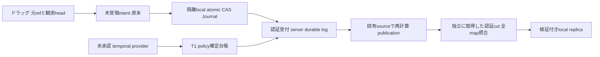

# D3 Occurrence intentと保存の追加契約案

## 1 対象と信頼境界

Firebase標準モード向けの提案規範。PR131 D1/D2およびPR128 B方式を維持する。新wire/schemaの番号や既存APIへのcastは割り当てない。拡張を知らないreader/writerは成功扱いせず原本を保持して停止する。E2EE/Drive/localのみの供給は別承認である。

server accepted、local persisted、publication applied、現在のconflict resolvedは独立した事実。serverはPWAのIndexedDB保存成功を独立に証明しない。過去applied/reflectionを現在conflictで消さず、accepted通知の到着順でawaitingが変わらないF1/F2/R-F2を維持する。

## 2 resourceと意図

全操作は認証Realm(mode/UID/scope/generation/control epoch)、actor/sequence/opId、command/group identity、不変payload、基準属性head集合と完全な依存closureを持つ。opIdは同payload再送だけに再利用し、同ID異payloadは保護停止する。旧世代の操作は現役へ自動適用しないが、原本を捨てずD4 intake対象とする。

|操作概念|対象とwrite-set|必須read-setと保存原本|
|---|---|---|
|anchor-create + move|OccurrenceRef=(definitionId, originalDateKey)。不変anchor＋schedule＋rank|sourceContextのbaseline/config/lifecycle/policy/tzRules閉包、release根拠、元outcome=pending、schedule/rank heads|
|move/reset|同refのschedule＋rank。resetは明示base|既存anchor原本、両heads、移動先の具体instant/暦日/zone、rank計算のbucket context|
|rank-only|同ref rankだけ|rank headと観測schedule context。scheduleを変更しない|
|complete/skip/cancel|同refのoutcome＋実績日時を一属性値として更新|元anchor/sourceとoutcome heads。cancelは明示pending＋取消来歴、古い完了日時を現値に残さない|
|resolve|未解決group/candidate集合へ明示新操作|見た候補の全heads。見ていない候補を解決済みにしない|
|policy transition|Routineの区間/frontier＋不変request結果|T0確認とT1確定を別保持。§5の専用providerが必要|

anchorの意味はPR131の全要素（baseScheduledAt/wallTime/offset/zone/tzRules/sourceKind/sourceContext/rule/lifecycle/旧確認）で比較する。hash一致だけで内容欠落を許可しない。同semantic anchorは一つのidentityへ正規化するが双方の要求・証拠は保持。異semantic anchorは一つのref内の候補として保護し、二つのTaskに分裂させない。

scheduleのbaseは旧overrideへのfallbackを再開する意味ではない。atはinstant/dateKey/zoneを一つの値として整合検証する。定義のrepeatRule/startsOn/dueAt、他Occurrenceの完了・順位はwrite-set外で不変。移動先に同じRoutineの別回があれば両refを共存させる。

## 3 atomic groupと競合

commandは完全なmember一覧、各memberの不変payload、read/write-setとrootを持つ。一部member欠落・同ID異payload・未知形式ではgroupを保留/保護し、残りだけをstateへ反映しない。server受付も全memberと送信義務の追跡可能性を保証し、publicationはgroupごとの一対一結果とmember来歴を保持する。既存N1の形式へ無理に詰めず、validator/reducer/coverage/result schema全体の追加レビューが必要。

因果headは単調カウンタだけでなく操作参照のfrontier。後続操作は観測した全headを基準にし、到着順・端末時計・Node revisionの全体勝者で決めない。各publicationは自己source logとbaselineだけから決定的に再計算する。current acceptedとの差Uを別に残し、U非空だけで恒久protectionにしない。source/coverageの単調性、全key/不変payload照合はPR128を維持する。

|組合せ|規範|
|---|---|
|別ref、本文とmove、moveとoutcome|独立属性を合成。完了実績の観測予定snapshotは不変。完了後の直接DnDは禁止だが、元pendingを観測した並行moveを到着時の値だけで拒否しない|
|同refの並行move|schedule＋rank group全体の代替候補を保持。片方のscheduleと他方のrankを解決済み値として合成しない|
|moveとrank-only|同じrankへの競合を含めgroup候補として表現。rank-onlyのwrite-set外を改変せず、移動groupも半分適用しない|
|first anchorと意味を変えるrule/close|生成根拠を因果的に照合。先行close/configを無視せず、真の並行は双方の意味候補を保全。初回anchorを現在ruleで捏造しない|
|明示base後の古いat、cancel後の古いcomplete|祖先操作は再反映しない。真の並行は候補に残す。異なる実績日時も値の一部であり同値に丸めない|

同じ集合の配送順列・重複・JSON再起動後にstateだけでなくheads/candidates/History/ledger/receipts/reflections/原操作が一致する正規化を要する。候補集合は決定的encodingで整列し、証跡の自動GCは行わない。

## 4 保存とUndo Redo

保存単位はbinding/checkpoint/state/ledger/protection/evidenceに、完全なanchor/source閉包、atomic group、History、pending publication inbox、receiptを含む。raw CASとJournalの契約を緩めず、保存成功前の採番消費・メモリ確定・Outbox退役を禁止する。server acceptedだけで原操作を削除しない。local CAS応答喪失はraw/Journalを保持して独立head/cutと照合し、不明なら停止する。旧RecoveryGuardをsnapshotから自己生成しない。

HistoryはPR131 D2のwriteSet(before/after/heads)、readSet、groupId、source、originalCommandRefs、compensationRefsを保持する。通常move Undo/Redoはschedule＋rank両方の因果headsが一致するときだけ新補償groupとして適用する。片側更新、同値だが新head、remote rank-only/schedule-onlyで旧Undoを無条件適用しない。真に並行の補償とremote操作はgroup候補として保全する。rank-onlyのUndoはrankのみで、schedule contextを検査する。

旧overrideの初回移動Undoは旧有効override＋旧rankへ戻し、anchorや過去履歴を消さない。完了/取消後のmove Undoは結果属性に触れず、完了時の観測予定も変更しない。旧Node全snapshotの復元は禁止する。

## 5 T1の時間条件と排他

T0の本人確認は予約ではない。policy要求は不変requestId/payload/B/T0/contextを保持する。T1で現役Auth/Realm/epoch、policy/config/lifecycle heads、tzRules、全ref根拠を再検証し、未anchorを含む一度release済み集合からF(T1)を得る。B>F(T1)、新zoneのB開始instant>T1、既存ref不変と区間非重複を同じ線形化点で検証・確定しなければならない。

providerへ求める不可分な条件は以下。

1. 全policy/config/lifecycle/anchor producerが同一fenceに参加する。複数tab/端末/workerをactor IDだけで排他したとみなさない。
2. commitの線形化点T1またはその保証された不確実幅を認証し、幅全体で述語が真であることを保証する。Treadとcommitの間の境界越えを成功にしない。
3. 同じ不可分な結果に新区間/frontier/control version、request結果、F/B/T1/検証したheads/sourceを含める。途中候補をactiveにしない。
4. request結果と現在frontierを別に読む。成功応答喪失後の同payload照会は当時の結果だけを返し、後続policyを巻き戻さない。同ID異payloadは拒否して原証拠保持。

Firestoreはtransactionをcommit timeで直列化するが、その性質だけではアプリ側で先読みした時刻述語がcommit時にも成立すると証明できない。[公式のisolation仕様](https://firebase.google.com/docs/firestore/transaction-data-contention)。RulesはgetAfterで関連書込を検査できるが、server SDKはRulesを迂回するため、全writerへの時間fence供給を別途立証する必要がある。[transaction仕様](https://firebase.google.com/docs/firestore/manage-data/transactions)、[server SDKとRulesの境界](https://firebase.google.com/docs/firestore/security/test-rules-emulator)。

**実providerの推奨評価順**は、commit点の時間preconditionを強制できる方式の成立性証明、または同等の期限fence＋全writer排他の成立性証明である。普通のtransaction/lease/定期heartbeat/事前時刻読取だけでは承認しない。現時点で供給可能との結論は出していない。成立性を示せなければpolicy activationと旧Routine初回policy適用を閉じる。T0でreleaseを凍結する別方式へ黙って変更しない。

anchor要求は同じfenceで直列化する。切替前に正当な旧anchorがあれば保全対象へ追加。切替後でもD<Bの旧区間の正当な回は許可できる。D>=Bの旧policy draftは隔離し、新zoneへ自動rebaseしない。anchorの有無でFを減らさない。時間や意味head変更で条件不成立なら旧区間/元ref/instant/anchor/要求/証拠を保持し、Bを自動で翌日へ変えず本人の新確認を要求する。

長期offlineでは既存の検証済みanchorへの操作を元binding付きpendingとして保持する。新たな日付のrelease/policy切替を端末時計で確定しない。再接続で現役cut/世代/epochと全sourceを照合し、変更意図と旧原本を残したまま明示再確認またはD4 intakeへ進む。
