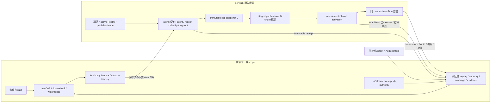
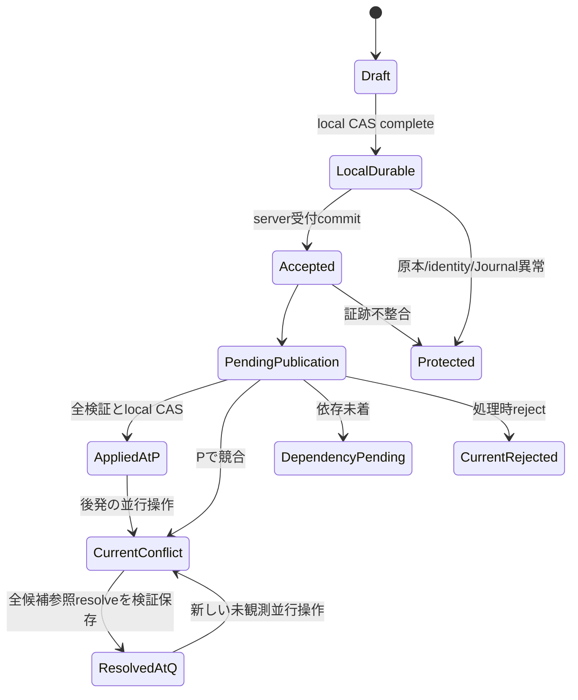

# 01 — Firebase標準モードのserver正本・検証付きreplica規範案

## 1. 用語・正本・保証限界

本書は[レビュー入口](README.md)のS判定単位。以下の型名は**概念仕様名であり新コードではない**。数値wire version、物理collection、署名suite等を既存型に仮割当しない。

- `Realm` = projectId + UID + mode + generation + baselineSeal + controlEpoch + activationId。generationは不変identityで、数値大小で勝敗を決めない。modeは本書ではFirebase標準に固定。
- `ReplicaBinding` = Realm + replicaId + actorId + actorIncarnation。server共通Realmと端末固有bindingを混同しない。旧Phase 1 Bindingとの対応は明示adapterで検査する。
- `IntentKey` = Realm + opId。`PayloadIdentity`は不変canonical intentの全内容。hash一致だけで原操作の一致を省略しない。
- `A(L)` = 不変server log snapshot Lに耐久受領された、IntentKeyとpayloadを対応付けた**有限map**。単なるopId集合でない。同一opId異payloadは二件の正常acceptedにせずsticky protection。
- `P` = 原子的activation済みpublication。`C(P)` = Pが検査対象に含めたaccepted map（coverage）。coverageは成功集合でなくconflict/pending/rejectedを含む処理対象。
- `U(K)` = cut K時点でacceptedだがPにまだ含まれないmap。server正本は検証済みbaseline、immutable intent/receipt、immutable publication/result、controlとその来歴。派生index・画面・時刻・SDK cacheは正本でない。

local persistedは端末のtransaction complete観測であり、独立した端末保存証明や永久保持ではない。server authorityは自分のlog保存を証明する。受領前の唯一のlocal copy/入力が失われた場合、その存在すら後日検出できないことがある。再接続が全local rollbackを検出するとは主張しない。

server/全端末/独立pinが同時後退した場合の完全検出、全server copyとbackupの喪失、悪意あるauthorityによる全omission防止は保証外。通常server故障・重複配送・到着順逆転は本書の検証対象。悪意あるJSやroot侵害の防御を本契約の成功条件へ偽装しない。

## 2. 信頼境界

署名root、初回enrollment、trusted clock/許容skew、session失効検証はsnapshot/backupから選ばない。署名が正しくてもexpected Realm/session/replica/purposeが違えば拒否する。P判定単位で実供給を承認するまで実SDKへ接続しない。

## 3. 耐久logと受付

### S1 受付transaction

1. serverは認証からproject/UIDを決定し、mode・active generation・controlEpoch・activationId・writer資格をcontrolと同じtransactionで検査する。client申告build/UIDで認可しない。
2. 同じIntentKey、actor/incarnation/seq、command identityに既存bindingがある場合、原不変payloadとの一致を検査する。同payloadの再配送は元receiptを返す。異payloadなら元記録と侵入候補双方を保存してRealmのsticky protectionを同じfenceで記録し、正常receipt/通常publicationを新規発行しない。元accepted事実は消さない。
3. 不正schema/意味不正等の受付前rejectは`AdmissionRejection`として原操作/理由/attempt identityを保全し、Aへ入れない。identity collisionの検査を通常rejectで隠さない。未認証通信は通常操作へ昇格させず、監査範囲・情報開示はPゲートで固定する。
4. 新規受領はintent、accepted receipt、identity index、immutable log entry、新しいL/root、control versionを一つのtransactionで成立させる。receiptはこのcommit後だけ返す。partial receiptは禁止。retry callback内で採番の外部確定/UI変更を行わない。
5. 同じrequest/同payloadの再照会・再送は再採番しない。acceptedは後でstatusへ上書きせず、結果はpublicationへ追記する。

`LogHead`はRealm、logId、parentLogHash、entriesRoot、acceptedMapRoot、controlVersionへ束縛する。内部ordinalはpagination順/穴検査に使えても受領・既処理の唯一根拠にしない。Aは全ancestorから再構築できる不変mapで、chunkのschema/順序/長さ/内容をrootへ束縛する。baseline由来の既存データはmigration baselineへ保持し、全部を新acceptedに捏造しない。

真正receiptのB wrapperは元receipt/不変payload identityに加えて、受領が成立したRealm、admission log head、controlVersion、受付identityを認証する。既存pure AcceptedReceiptの原bytesは保持する。後のKで当該headがancestorなら、そのacceptedがA(L)に含まれることを必須検査する。署名receiptがあるのにserver logが欠落させた場合を、Outboxが空だから正常と扱わない。

### S2 canonical/hash

新wrapperはdomain分離した`H(domain, canonical typed record)`で識別する。canonical表現はUTF-8、schemaで許可したキー/型、安定キー順、配列順、有効な有限安全整数、欠落/null/falseの区別、文字列の無断Unicode正規化なしを必須とする。unknown schemaは停止。既存Phase 1のcanonicalIntent bytesは既存方式のまま保持し、wrapperの再encodingで同一opの意味/receiptを変更しない。

review後のS実装仕様でtest vectorを固定し、曖昧なencodingやbinary/数値の暗黙変換を拒否する。digestは整合性検査であり、それ自身は真正性や永続化証明でない。全map照合時にはcanonical原payloadも比較する。

## 4. publication・activation・publisher再開

### S3 閉じた入力と完全coverage

標準モードの各publication候補Pは、単一のimmutable source log head `Lp`とbaselineを選び、**C(P)=A(Lp)**を満たす累積snapshotとする。任意の「処理済み部分集合だけのpublication」は本規範では許可しない。祖先/dependencyが未着でも当該intentをcoverageへ含め、dependency-pendingとして保全する。未来操作を推測で追加しない。

PはRealm、前activation済みcheckpoint、source Lp、coverage map root、全intent/member/chunk inventory、**そのsource時点の**field heads/projection/result/conflict/dependency/rejection/protection roots、command group、reducer/schema versionを認証する。各covered opに当該PでのApplicationResultを**一つだけ**持たせる。statusはapplied / conflict / dependency-pending / rejected（処理時reject）。過去結果/過去reflectionは別の不変来歴として保持する。現在Kのcontrol protection/受付rejectとは別である。

Pを作っただけではserver publicationでもlocal appliedでもない。純粋な`makePublication`出力を署名済みactivated manifestへ昇格させるにはS4が必要。

### S4 atomic activation

1. publisherはRealm、leader fencing token、期待previous checkpoint、source Lpと不変jobIdをdurable stagingへ保存する。chunkはcreate-only・内容固定。chunk/page位置もhashで束縛する。
2. 全chunk・coverage・payload・result・baseline・DAG・意味制約を検証し、inventory rootと検証記録をdurable化する。一部だけstage済みならcurrent Pにしない。サイズ上限を越える巨大transactionに頼らず、不変chunkと小さいactivation rootを分離する。
3. activation transactionは同一controlに対してcurrent Realm/epoch/activationId、publisher fence、expected previous checkpoint、検証済み不変inventoryへの参照に加え、**`Pprev.sourceLogHead ≼ Pnew.sourceLogHead ≼ current L`**と**`C(Pprev) ⊆ C(Pnew)`**を必須検査する。≼は同Realm内で全祖先chainを検証した同一またはancestor関係、⊆はkeyと全不変payloadの一致するmap包含であり、seq/件数/hash値の大小ではない。検証記録は比較したPprev/Pnew/source/coverageへ束縛し、transaction内でcurrent previous/fenceが一致することを再確認する。source/coverage後退、比較不能log、同ID異payloadは通常activation禁止。正しいpreviousと現役publisherだけでは許可しない。publication pointer/checkpointとcontrolVersionを不可分更新する。新規acceptedがLp以降に増えていてもsourceを改変しない（その差はU）。
4. 同じjobId/同manifestの再実行は元activation結果へ冪等に収束。違うmanifest、同checkpoint異hash、別leaderの旧fenceは保護/拒否し、先着chunkで勝者を捏造しない。世代切替は同じcontrol fenceで直列化する。
5. activated memberを後で上書き/削除しない。staging/結果/証拠のGCは今回の契約外。sticky protection中は通常projectionへの新activationは禁止。診断用protection記録は別rootへ追記し、旧正常Pはread-onlyの最終既知値として残す。

publisher crash復旧: jobIdからstagingを再読込→全chunk再照合→controlのactivation結果照会→未activationなら同expected previous/fenceで再試行。既に別Pが進んだら古い候補をactivateせず新しいpreviousに対する別jobを作り、旧job証拠を保持する。完成したchunkの存在だけでactivation済みと推定しない。server process再起動でfenceを再利用しない。

**同一sourceのno-op publicationは許可する。** 同Realm・baseline・reducer/schema versionのまま、Cと意味state/results/candidates/projection/保護・group rootsがPprevと完全一致し、全通常activation条件を満たす場合だけ、previous/新checkpoint/不変job等のpublication来歴を進められる。同一job再配送は新checkpointを作らない。同一sourceで意味結果を変更する再解釈/復旧/validator更新はno-opではなく別承認。genesis P0のsourceは当該Realmの空log rootとして定義し、以後同じ単調性を適用する。

後退候補の拒否ではcurrent server control（L/P pointer、checkpoint/controlVersionを含む）と既存publicationを更新しない。拒否job/候補・理由は既存rootを上書きしない追記専用診断領域へ保全する。clientも候補を適用せずstate/checkpoint/ledger/reflection/既存原証拠を不変とし、候補の診断原証拠は別途追加できる。既存sticky protectionを解除しない。identity衝突の新発見はS1の別保護fenceに従うが、拒否候補を正常Pへactivateする理由にはしない。

## 5. consistent cutの定義と照合アルゴリズム

### S5 一つのcontrol rootからの応答

`CutCertificate K`はformat/purpose、Realm、expected ReplicaBinding、session/audience、request nonce、issuedAt/expiresAt、controlVersion、**LとPの不変参照**、U root、当該Pのresult partition roots（source時点）、現在cutのadmission rejection/control protection roots、inventory rootを完全署名対象にする。replica bindingは宛先検査であり端末rawを証明しない。Pのcoverage/source Lpとprevious chainもKへ束縛される。

serverはcontrolのL/P/protection/epoch pointersを**一つのread transactionのsnapshot**から取得する。不変参照先の列挙はtransaction外でもよいが、同じroot配下のデータに限る。Uとpartitionは当該L/Pから決定的に計算し署名し、mutable queryを混ぜない。更新が途中で発生してもKは取得した過去時点の一貫したcutであり、未来の不変leaseでない。K発行時にsession失効/世代切替を再検査し、変化したら古いrootを現在資格として返さずretry/retiredにする。直後の失効を瞬時に全端末へ伝える保証ではない。

ページ取得tokenはK hash、root、page index/total、前後位置・範囲へ束縛する。全inventoryを再構築するまで検証未完。最適化したMerkle非包含証明だけで全件照合を省く方式は別レビュー。本初版は**全map取得・全比較**で完全性を確認する。大きすぎて全件を取得できないなら未検証として停止/待機し、件数一致で代用しない。

### S6 照合手順（規範擬似手順、製品コードでない）

1. 独立rootでKの署名、purpose、期待Realm/replica/session/nonce、期限・信頼時刻を検証。cold startでもnonce再利用禁止。K.controlVersion/P/Lを耐久pinと比較し、既知のancestorへ後退、同ID異hash、異世代混入は保護。新しいcurrent cutがold pinと比較不能なら推測採用しない。
2. Lの全entry/ancestor/inventoryを検証しA(L)を再構築。duplicate identityの同payloadは同一entry、異payload/欠落/余分/穴は保護。既保持の真正receiptのadmission headがL以前なら全payloadの包含を必須検査する。Lより後の真正receiptを既に保持しているならKは不足cutとして完了判定不可、次cutを照会する。比較不能なheadは分岐として保護。Pの全chunkとprevious chain、baseline、source Lpを取得し、LpがLのancestorであることを検証。clientの連続publication chainでもS4と同じ`Pprev.source ≼ Pnew.source ≼ K.L`および全payloadによる`C(Pprev) ⊆ C(Pnew)`を検査する。source後退/比較不能/coverage後退/同ID異payloadは通常適用を拒否し、既存Phase 1の`operation-coverage-regression`検査も維持する。同一sourceのno-opはS4の完全一致条件を検証する。
3. A(Lp)を再構築し`C(P) == A(Lp)`を**keyと全不変payloadのmap同値**で確認。CにA(L)外のkey、payload差、同opId別variantがあれば拒否/保護。
4. `Ucalc = A(L) \ C(P)`を計算。KのUを全取得し`U(K)==Ucalc`、`C∩U=∅`、`C∪U=A(L)`をmap比較する。重複pageで欠落を相殺する件数比較は禁止。
5. Pの全covered opについて結果を一対一照合し、集合をApplied / Conflict / DependencyPending / Rejectedへ漏れなく・重複なく分割する。全resultのopIdと元payload/context/command groupを照合。非covered opのresultも拒否。保護記録は別軸で必ず検査し、4分類に押し込んで消さない。
6. 標準モードでは**当該P固有のbaselineと`A(P.sourceLogHead)=A(Lp)`のみ**を入力に承認済みpure reducerを再実行し、Pのstate/results/candidates/projection/保護・group rootsと完全一致を検証する。現在log Lの`A(L)`は現在accepted全体とUの照合（手順2–4）に用い、`A(L) \ A(Lp)`を過去Pの意味検証に混入しない。P1/P2等の履歴も各Pi固有のbaseline/source `Lpi`で別々に再計算する。Kの現在control protection/AdmissionRejectionは別軸で検査し、Pのsource時点の意味状態/結果rootへ混ぜない。現在の阻害要因はcompleteをfalseにするが、正しかった過去Pのreflectionを消さない。正常なU非空cutはP検証成功・U保持・complete=falseであり、Uがあるだけで恒久protectionにしない。hashだけの検証で意味正当性を飛ばさない。unknown reducer/schemaは停止。E2EEへこの手順をそのまま適用する承認はない（02参照）。
7. 検証済みK、受領証拠、Pのcheckpoint/state/ledger/evidence、inbox処理とserver/local境界を一候補としてlocal raw CAS保存する。保存前はmemory/seq/Outbox退役/serverConfirmedを確定しない。K期限切れ/新操作での同期判定失効も反映する。
8. S8の全条件が成立する場合だけ`completeAt(K)`を返す。どこかのpage/receipt/result不足はunknown/pendingであり、空集合に補完しない。

期限は受信時だけでなく照合中・local CAS直前・CAS完了後の同期判定時にも検査する。照合中/直前にKが失効したらfresh確認としての保存/適用を開始せず、現在のdurable state/checkpoint/ledger/reflectionを保持してfresh Kを再取得する（隔離受信原証拠の追記は別）。CAS開始後に期限が来てcommitした場合はその保存事実を保持するがfreshness unknown/complete=falseとし、完了を取り消せたと偽らず次cutで再検証する。期限切れだけで過去reflectionを消したり恒久protectionにはしない。

activation済みでもmemberを取得できなければ未検証/pendingで空補完しない。改変/hash不一致が判明したら保護停止し、候補を新state/checkpointへ適用しない。別UID/scopeのraw/通知は宛先のDomain/Committed/Journal/Outboxへ保存しない。元の正しいscopeへ戻せる場合だけそのscopeの入口で再検証し、それ以外はopaque診断隔離へ保存するか拒否する。誤ったscopeのDomainへ「保全」の名目で混入させない。

P2先着でP1が未取得ならP2はpendingとする。先行chainを全検証しPhase 1の順序制約どおりP1→P2をreplayしてから保存する。中間P1で完全に検証されたappliedのreflectionはP2がconflictでも保持する。chainのcoverage参照だけ、またはP1のhashだけから反映証跡を作らない。

genesis P0はbaselineSealへ束縛されC=空、全result空。Lが空でなければU=A(L)。baseline構築を「全既存操作がaccepted済み」と読み替えない。新acceptedは次cutのAへ入り、K検証途中でlive listenerが増えた場合は混ぜず次cutを要求する。

## 6. 四状態・ローカル境界

### S7 四状態は一本道でない

AppliedAtPは歴史的事実で、CurrentConflict/Protectedへ移ってもreflectionを消さない。R/P1/P2の通知順に依存せず、検証済み原intent・receipt・反映来歴からledgerを正規化する。coverage/opId一致だけではhistorical appliedへ昇格しない。最初からconflict/dependency-pendingの操作にはapplied証跡を作らない。resolveは新intentであり既存候補の書換えではない。

自端末新規操作はlocal CAS成功した同一intentのみ送信可能。受信端末にlocal intentがない他端末/MCP操作もserver receipt/publicationを検証して取り込める。receiptがlocal保存される前にserver acceptedが成立すること、publicationがreceiptより先に届くことは正常な順序として扱う。

`ReplicaEnvelopeB`（新型）はserver由来の認証済みbaseline/log/receipt/publication履歴と、local-only durable intents、未送信Outbox、awaiting、inbox、History/Undo/Redo、local settings/source refs、protection、採番、raw ancestry、検証済みcut/pinを一つのatomic unitへ束縛する。大容量source archiveはimmutable内容の耐久化・再読込検証前にpointerを進めない。

local-onlyは配列末尾の位置ではなく、**local intent mapから検証済みaccepted factsを差し引いた未受領集合**。通称suffixでも別属性/別actor/到着順の穴を含み得る。serverにないことを削除要求にせず、既存opId/payloadを保持する。server-confirmedとlocal-onlyをstorage/UI/statusで区別し、local checksumをserver真正性へ昇格しない。

### S8 同期完了の必要十分条件（観測時点限定）

Firebase標準の`completeAt(K)`は以下の**全て**が成立する場合だけtrue。

1. S5/S6を全件検証したfresh Kがexpected Realm/sessionに有効であり、pin後退なし。
2. localのdurable applied checkpointがK.Pと同一で、Pのstate/results/evidence/inbox処理をCAS保存済み。K保存後の未照合受信・ローカル変更・Auth/control切替がない。
3. `U(K)=空`、K.Pの現在Conflict/DependencyPending/Rejected=空、control/publication/localのprotection=無。受付rejectも未解決なら阻害要因。historical resolved conflictは来歴として保持し、現在件数と混ぜない。
4. localのunreceived、awaiting、queued/pending/rejected inbox、未処理events、保存待ち/debounce/draft、通信中結果未確定、未完了recoveryが全て0。draftを同期対象外とする場合でも「保存済みデータのみ同期済み」と別表示し、全体completeはtrueにしない。
5. expected actor/incarnation/writerが現役で、server/backend・時刻の真正性が不明でない。offline/期限切れならfalse/unknown。

receiptや過去reflectionが揃ってawaiting=0でもcurrent conflictが残ればfalse。他端末のaccepted未処理がUにあれば、自端末Outboxが空でもfalse。rejectedはsuperseded ACKへ置換しない。明示処置で解消した受付rejectの履歴は残すが、未解決処置判定は別仕様/レビューが必要で、未定義なら同期阻害を維持する。

完了表示は「Kのcut時点で保存済みデータの照合完了」。新ローカル入力/notice、新cut、失効、期限到来で無効化する。全端末の未来同期やoffline中の他端末操作不存在を保証するleaseではない。

## 7. hydration・offline・復旧

### S9 別型・別入口

既存`RecoveryGuard`/`hydrate`/`LocalIntentStore.open`は外部exact-current-local floor契約のまま維持する。B用に`ServerAnchorB`（server root/manifest/cut認証）、`LocalIntegrityB`（端末内raw整合性/CAS pin。独立真正性なし）、`ReplicaEnvelopeB`と`openReplicaB`を**新設**する案。RecoveryGuardを自己生成して既存openへ渡すadapterは禁止。

openReplicaBはraw/Journalを最初に読み原本保持→format/context/local history検査→全event replay/immutable payload/reflection参照再検証→server基点とlocal-only区分を照合する。unknown raw/format、Journal非空、scope/世代差、history欠落、hash/member/祖先/反映参照改ざんはprotected。serverが新しいことを理由に保護停止を解除しない。

既にenroll済みの端末は検証済みlocal baselineと保存済みserver証拠からoffline read/local CASを許せる。ただしfreshness unknown、未受領操作の真正性は独立保証外。初回bootstrap、未知generation、鍵未解放、既存protection中は編集停止。offlineで認証失効/世代切替を即時検知できず、再接続時の受理拒否があり得ることを示す。

保存したcut/receiptの署名とpayloadは再検証するが、期限切れKをfresh Kとして使わないことと、過去の検証済みreceipt/reflectionを消すことは別。expiry到来だけで過去accepted/appliedを取り消さず、serverFreshnessをunknownへ落とす。既知root/認証履歴を検証できない場合は停止する。署名鍵失効が過去署名へ及ぶ範囲とroot更新手順はP単位で固定するまで、失効根拠不明の証拠を再認証しない。

旧backupは候補原本。旧server checkpointでlive pinを戻さず、別replica/workspaceで検証する。backupのroot/guardを信頼根拠にしない。serverにある操作は同payloadで照合し、未受領操作/History/設定/unknown fieldsは別保全する。restoreでactorを複製して新規採番に使わず、新incarnationは明示enrollment後に作る。旧opの再送は旧identityを保持する。

再接続ではhandle/context再検査→fresh K→S6→保存済み未受領opのopId+payload照会→照合済みreceipt/pubをdurable inboxへ→drain/CAS→次cutの順。世代違い/旧sessionの応答は旧scopeへ隔離し、新bindingへ書換えない。通常offlineからの復帰で既存protectionを自動解除しない。比較可能なserver head/pin/receiptの範囲だけrollback検出可能で、全未受領証跡の喪失は検出不能な場合がある。

### S10 crash窓ごとの復旧表

|窓|耐久根拠/許される復旧|停止・保証限界|
|---|---|---|
|draft/debounce中、CAS前|保存を確定するか独立draft退避後に次処理|未保存入力は復元保証なし。serverへ先送信禁止|
|CAS中abort/quota/crash|旧Committed/Journalと保護原本を保持。採番/メモリ/Outbox未確定|非null Journal/未知rawは保護、clear/replay推測禁止|
|CAS成功、complete応答喪失|最後に検証したexpected/候補と同identityでraw再読込・全replay。target一致なら元opを回収、旧rawなら同要求の明示再試行|どちらでもないrawなら保護。新ID採番/未確認送信禁止。候補情報も失われれば原本解析から安全に確定できるまで停止|
|local保存後・server受領前|同opId/payloadを照会/再送。local原本を残す|唯一copy消失なら存在検出・復旧不能。「この端末の未送信変更は復元できない可能性」。空データ/同期完了と表示しない|
|受付transaction中crash|intent/receipt/identity/root全成立か不成立。fresh認証でopId+payload照会|timeoutを未受領と断定しない。照会不能はunknown|
|accepted commit後・応答/receipt CAS前|同opId照会で元receipt回収、receipt+awaiting移動をlocal CAS|OutboxはCAS前退役しない。server受領事実を消さない|
|accepted後・publisher前crash|durable AとPからU再構築、source cutを固定してjob再開|最大seqで未処理を飛ばさない|
|chunk staging/activation前crash|job/inventoryを全再検証、同fence/expected predecessorでactivate|未公開chunkをcurrentにしない|
|activation成功・応答喪失|control/jobIdから元manifest結果を取得|別Pが進んでも旧jobを新checkpointとして二重activateしない|
|publication受信・inbox/CAS前後crash|durable inbox再処理またはserver同manifest再取得。原本/全evidence再検証|過去appliedと現在conflictを分離、欠けたreflectionを捏造しない|
|Auth/epoch切替中CAS/通信|旧handle retire、開始済みtransactionの終結待ち、旧scope原本保全、新sessionで照会|既開始CASを必ず取り消せるとはしない。旧responseを新scopeへinstall禁止|
|server outage/backup後退|local保存とserver unknownを分離。独立pin/receiptに反するheadは保護|server全喪失や全pin同時後退は自動復旧不可。管理復旧/新epoch/両端末照合を別承認|
|local全消失・accepted済み|独立bootstrap後、server baseline/log/全証拠を別replicaへ再構成し検証|local-only/端末設定/History等はbackupなしなら復元不能。server内容だけで完全復旧と称さない|

復旧は原本を別保護した明示手順。authority到達やsigned headだけでprotectionを解除しない。移行はPR #123の一度限り方式B、draft確定/freeze/drain/両端末排他/全永続種別全件照合を維持。rollbackは新世代操作を失う旧snapshot再公開を禁止し、対応clientでのforward recovery/別承認復旧とする。
